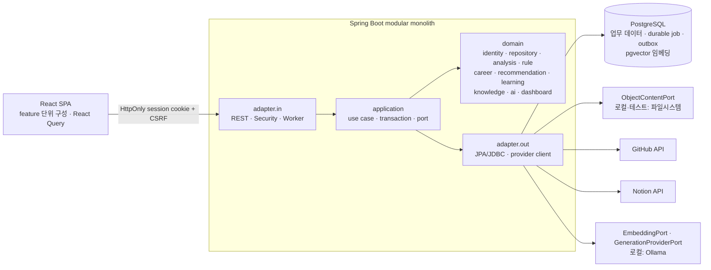
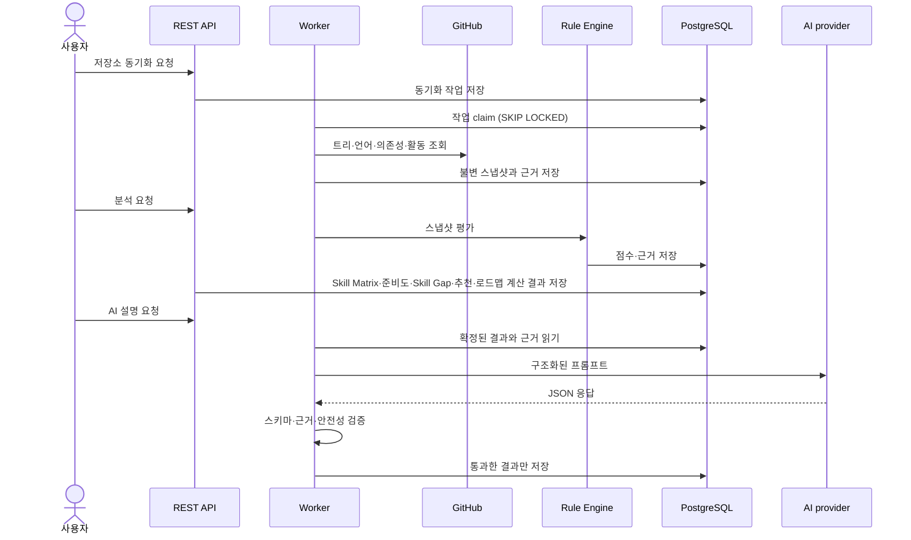
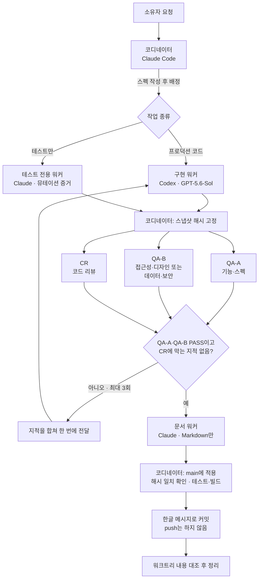

# DevPath

GitHub 저장소와 Notion 학습 기록을 근거로 개발자의 현재 역량과 다음 학습 방향을 보여주는 서비스입니다.

GitHub를 꾸준히 관리해도 "이 프로젝트가 어떤 역량을 보여주는가", "백엔드 개발자를 목표로 하면 무엇이 부족한가" 같은 질문에는 답하기 어렵습니다. 커밋 수나 언어 비율로는 구조, 테스트 습관, 문서화 수준이 드러나지 않기 때문입니다. DevPath는 저장소를 스냅샷으로 고정해 규칙 기반으로 분석하고, 목표 직무에 맞춘 준비도와 학습 로드맵을 계산한 뒤, 그 결과를 AI가 근거와 함께 설명하도록 만든 개인 프로젝트입니다.

현재 상태는 로컬 환경에서 동작하는 MVP입니다. GitHub 로그인부터 저장소 동기화, 분석, Skill Matrix, 커리어 준비도, 추천과 로드맵, 대시보드까지 이어지는 흐름이 구현되어 있고, Notion 지식 검색과 AI 설명은 구현을 마쳤지만 소유자 승인과 실제 provider 점검이 남아 있습니다. 운영 배포는 하지 않았습니다.

## 핵심 원칙

**공식 점수는 Rule Engine만 계산합니다.** LLM이 점수를 매기면 같은 입력에도 결과가 달라지고, 왜 그 점수인지 설명할 수 없습니다. 그래서 점수, 가중치, 준비도, 추천 우선순위는 버전이 붙은 결정론 규칙(`readiness-v1`, `recommendation-v1`, `roadmap-v1` 등)으로만 계산하고, 같은 스냅샷과 같은 규칙 버전이면 같은 결과가 나오도록 했습니다. 목표 직무를 바꾸면 적용되는 평가 규칙이 바뀝니다.

**AI는 계산된 결과를 설명만 합니다.** AI 응답은 검증을 통과하기 전까지 신뢰하지 않습니다. 응답은 정해진 JSON 스키마를 지켜야 하고, 인용한 evidence ID가 실제 분석 근거에 있어야 하며, 숫자를 포함한 문장은 추적할 수 없는 수치 주장으로 보고 거절합니다. HTML이나 스크립트가 섞이거나 시스템 프롬프트가 노출되어도 거절합니다.

**사용자 데이터는 조회 단계에서 격리합니다.** 모든 사용자 소유 데이터는 `user_id`로 범위를 제한하고, 권한 확인은 조회, 프롬프트 조립, 생성보다 먼저 일어납니다. 벡터 검색도 예외가 아니어서, 유사도 계산 전에 사용자·소스·문서 상태·임베딩 모델 조건으로 후보를 먼저 거릅니다.

## 주요 기능

### 구현됨

- **GitHub 로그인과 세션**: GitHub OAuth2로 로그인하고, 서버가 관리하는 HttpOnly 세션 쿠키와 CSRF 토큰으로 요청을 보호합니다. GitHub 계정과 내부 `User`는 분리되어 있습니다.
- **프로필과 목표 설정**: 온보딩에서 목표 직무(Backend/Frontend)와 목표 기업을 고릅니다. 목표 변경은 확인을 거치는 명시적인 동작입니다.
- **저장소 연결과 동기화**: GitHub 연결 후 저장소를 찾아 가져오고, 동기화할 때마다 파일 구조, 언어, 의존성, 활동 이력을 불변 스냅샷으로 저장합니다. 보관과 복원도 지원합니다.
- **결정론 분석**: Rule Engine이 스냅샷을 분석해 점수와 근거 링크를 남기고, 분석 이력과 두 분석의 비교를 보여줍니다.
- **Skill Matrix**: 분석 결과로 기술별 역량 평가를 만들고, 기술마다 불변 이력과 비교 화면을 제공합니다.
- **커리어 준비도와 Skill Gap**: 직무 카탈로그 기준으로 준비도와 부족한 역량을 계산합니다.
- **추천과 학습 로드맵**: 준비도 결과에서 결정론 추천과 단계별 로드맵을 만듭니다.
- **대시보드**: 위 결과를 한 화면에 요약합니다.
- **Notion 지식 검색** (승인 대기): Notion OAuth 연결 후 공유된 페이지를 정규화·청크 분할하고, Ollama 임베딩을 pgvector에 저장해 사용자 범위 안에서 인용과 함께 검색합니다.
- **AI 설명** (승인 대기): Skill 분석 설명, 저장소 리뷰와 요약, 커리어 코칭, 학습 추천을 생성합니다. Ollama 생성 어댑터를 provider 포트 뒤에 두었고, 취소와 제한된 재시도를 지원하며, 검증을 통과한 결과만 저장합니다.

### 계획 중

기업별 준비도와 추천 보정은 MVP 이후로 미뤘습니다. 생성 결과 목록·수동 재시도·편집·내보내기, 포트폴리오·이력서·면접 준비 문서 생성, 관리자 기능은 아직 구현하지 않았습니다. 운영용 관측, 배포 플랫폼, 시크릿 관리는 관련 ADR(ADR-031, 033, 034)이 Proposed 상태라 결정 전까지 손대지 않습니다. 기능별 상태는 [`docs/21_Feature_Status.md`](docs/21_Feature_Status.md)에 정리되어 있습니다.

## 아키텍처

Backend는 하나의 Spring Boot 애플리케이션 안에 기능 모듈을 나눈 modular monolith입니다. 모듈마다 `domain`, `application`, `adapter.in`, `adapter.out`으로 나누고, `domain`은 Spring, JPA, HTTP, provider SDK에 의존하지 않습니다. 이 규칙은 ArchUnit 테스트로 확인합니다.



핵심 데이터 흐름은 아래와 같습니다. 동기화, 분석, 지식 수집, AI 생성은 모두 PostgreSQL에 저장된 작업을 워커가 가져가 처리합니다.



## 설계에서 고민한 점

**modular monolith와 hexagonal 경계 (ADR-001, 002).** 혼자 개발하는 프로젝트에서 서비스를 처음부터 나누면 배포와 데이터 정합성 비용이 기능보다 커집니다. 대신 모듈 경계와 포트를 엄격하게 두어, Controller는 JPA Repository를 직접 쓰지 않고 트랜잭션은 application 서비스가 소유합니다. GitHub, Notion, AI 호출은 긴 DB 트랜잭션 밖에서 실행합니다.

**PostgreSQL 기반 durable job (ADR-010, 027).** 별도 메시지 브로커 없이 작업 테이블과 트랜잭션 outbox를 PostgreSQL에 두었습니다. 동기화·분석·AI 워커는 `FOR NO KEY UPDATE SKIP LOCKED`, 지식 수집 워커는 `FOR UPDATE SKIP LOCKED`로 서로 다른 행을 가져가고, 취소에 쓰는 ID 단위 잠금은 그대로 막히게 했습니다. AI 작업에는 15분 lease와 `next_attempt_at`을 두어, 워커가 죽으면 lease가 끝난 뒤 30초부터 최대 5분까지 간격을 늘려 재시도하고 시도 한도에 닿으면 `WORKER_LEASE_EXPIRED`로 실패 처리합니다.

**불변 스냅샷과 버전 있는 규칙 (ADR-008, 009).** 분석 결과를 재현하려면 입력과 규칙이 모두 고정되어야 합니다. 동기화마다 새 스냅샷을 만들고 이전 스냅샷과 분석 결과는 수정하지 않습니다. 대량 저장 시 엔티티마다 SELECT 후 INSERT가 나가던 문제는 `Persistable`과 JDBC batch로 고쳐, 파일 500개짜리 스냅샷 저장이 prepared statement 3개로 줄었습니다(C-2). 스냅샷 목록도 전체 hydration 대신 요약 쿼리 하나로 바꿨습니다(C-1).

**AI 출력 검증 게이트 (ADR-006, 015, 030).** AI는 Rule Engine이 확정한 결과와 근거만 입력으로 받습니다. 기능마다 전용 validator가 응답 스키마, evidence ID의 실재 여부, 숫자 주장, 렌더링 안전성을 확인하고, 실패한 응답은 저장하지 않습니다. 임베딩과 생성은 기능별 포트로 분리해 provider를 바꿔도 domain과 API가 바뀌지 않게 했습니다.

**pgvector와 필수 메타데이터 필터, 세션 인증 (ADR-014, 026, 028).** 벡터 검색 쿼리는 사용자 ID, 활성 Notion 연결, 문서 수명 상태, 임베딩 provider·모델·차원 조건으로 후보를 먼저 거른 뒤 거리를 계산합니다. 인증은 SPA에 JWT를 두지 않고 서버 세션(Spring Session JDBC)으로 처리해, JavaScript가 세션 ID나 provider 토큰을 읽을 수 없게 했습니다. provider 토큰은 암호화해 저장합니다.

UI는 `DESIGN.md` 기준으로 접근성 점검을 거쳤습니다. 공용 확인 대화상자의 포커스 처리, 폼 오류 요약, 색상 토큰, 비교 표의 스크롤 영역과 44px 터치 대상을 정리했고(UX-3~5), Playwright 테스트에서 axe 검사를 함께 돌립니다.

## 기술 스택

| 영역 | 사용 기술 |
|---|---|
| Backend | Java 21, Spring Boot 3.3.5, Spring Security, OAuth2 Client, Spring Session JDBC, Spring Data JPA, Gradle |
| Data | PostgreSQL, pgvector, Flyway (V1~V29) |
| Frontend | React 18, TypeScript, Vite, React Query, React Router |
| AI / Knowledge | Ollama 임베딩·생성 어댑터(로컬), provider 포트 |
| 계약 | OpenAPI (`contracts/openapi/devpath-openapi.yaml`), Redocly lint |
| 테스트 | JUnit 5, ArchUnit, Testcontainers(`pgvector/pgvector:0.8.0-pg16`), Vitest, React Testing Library, Playwright + axe |

## 프로젝트 구조

```text
DevPath/
├── backend/      # Spring Boot 애플리케이션 (com.devpath.<module>)
├── frontend/     # React 애플리케이션 (src/features/<feature>)
├── contracts/    # OpenAPI 계약
├── docs/         # 요구사항, 엔진 명세, 아키텍처, ADR, 로드맵 (영문 원본)
├── docs_ko/      # docs 번역본
├── fixtures/     # Rule Engine 결정론 테스트 데이터
└── scripts/      # 빌드·테스트·보안 검사 래퍼
```

## 로컬 실행

필요한 것: JDK 21, Node.js와 npm, pgvector 확장을 쓸 수 있는 PostgreSQL, GitHub OAuth App. Notion 연결과 AI 기능을 쓰려면 Notion integration과 로컬 Ollama(`http://localhost:11434`)가 추가로 필요합니다.

GitHub OAuth callback URL:

```text
http://localhost:8080/login/oauth2/code/github
```

환경 변수 목록과 예시는 `backend/.env.example`에 있습니다. Spring Boot는 이 파일을 읽지 않으므로 값을 프로세스 환경 변수로 넘기거나, `backend/.env`로 복사해 두면 `bootRun` 태스크가 이미 설정되지 않은 변수만 채워 넣습니다.

```powershell
# Backend
$env:SPRING_PROFILES_ACTIVE = "local"
cd backend
.\gradlew.bat bootRun
```

```powershell
# Frontend
cd frontend
npm ci
npm run dev
```

| 대상 | 주소 |
|---|---|
| Frontend | `http://localhost:5100` |
| Backend | `http://localhost:8080` |
| PostgreSQL (local 프로필 기본값) | `localhost:15432` |
| Health check | `GET /internal/health` |

## 테스트

저장소 루트에서 실행합니다.

```text
npm run backend:test
npm run backend:build
npm run frontend:install
npm run frontend:test
npm run frontend:build
npm run frontend:e2e
npm run verify
npm run verify:mvp
```

Backend 통합 테스트는 Testcontainers로 pgvector PostgreSQL을 띄우므로 Docker가 실행 중이어야 하고, H2로 대체하지 않습니다. Gradle은 JDK 21이 필요합니다. `npm run verify:mvp`는 Docker 확인, 보안 경계 검사(`npm run security:check`), backend clean build, frontend 테스트·e2e·빌드·`npm audit`, OpenAPI lint를 순서대로 실행합니다.

## AI 에이전트 개발 흐름

이 저장소는 Orca로 여러 AI 에이전트를 조율해 개발합니다. 에이전트마다 맡는 일이 정해져 있고, 구현한 쪽과 검토하는 쪽을 분리합니다. 자세한 규칙은 `CLAUDE.md` §12~§14와 `AGENT.md` §14~§16에 있습니다.

### 역할

| 역할 | 에이전트 / 모델 | 하는 일 | 하지 않는 일 |
|---|---|---|---|
| 코디네이터 | Claude Code (Claude) | 작업 계획, 스펙 작성, 워커 배정, 스냅샷 고정, 결과 검증, main 반영과 커밋 | 직접 구현, 자기 작업 검토 |
| 구현 워커 | Codex (GPT-5.6-Sol) | 프로덕션 코드 구현, 관련 테스트 작성, 리뷰 지적 수정 | 계획, 문서 작업, 리뷰 |
| 테스트 전용 워커 | Claude (별도 세션) | 테스트만 추가·보강하는 작업. 새 테스트마다 뮤테이션 증거 제출 | 프로덕션 코드·설정·마이그레이션 변경, 발견한 결함 수정 |
| 리뷰어 QA-A | Claude (별도 세션) | 기능·스펙 충족, 회귀, 테스트가 실제로 문제를 잡는지 | 파일 수정 |
| 리뷰어 QA-B | Claude (별도 세션) | 프론트엔드: DESIGN.md·WCAG 접근성 / 백엔드: 데이터 일관성·동시성·보안 | 파일 수정 |
| 리뷰어 CR | Claude (별도 세션) | 코드 리뷰: 정확성 버그, 가독성, 중복, 코딩 표준 | 파일 수정, 테스트 실행 |
| 문서 워커 | Claude (별도 세션) | 리뷰를 통과한 변경만 지정된 Markdown 파일에 반영 | 코드·설정 변경, 결과 지어내기 |

### 흐름



### 원칙

- **구현과 검토 분리**: 프로덕션 코드는 Codex가 쓰고 Claude가 검토합니다. 같은 모델이 쓰고 검토하지 않도록 모델을 나눴습니다.
- **독립 리뷰 3개**: 리뷰어 3개는 서로 맥락을 공유하지 않는 별도 세션이며 모두 읽기 전용입니다. 3회 안에 통과하지 못하면 커밋하지 않고 멈춥니다.
- **스냅샷 고정**: 리뷰는 diff 해시로 고정한 스냅샷을 대상으로 하고, main에 적용한 diff가 같은 해시인지 확인한 뒤에만 커밋합니다.
- **테스트 전용 작업**: 위험이 낮은 테스트 보강은 Claude 워커가 맡습니다. 대상 동작을 일부러 망가뜨려 테스트가 실패하는 것을 보여야 하고, 찾은 결함은 고치지 않고 Codex 작업으로 넘깁니다.
- **사람이 결정하는 것**: 제품 결정, 스펙 변경, 커밋 승인, push·배포는 소유자가 정합니다. AI가 점수를 계산하지 않는다는 제품 원칙도 이 흐름 안에서 그대로 지킵니다.
- **사용 한도 대응**: Codex 사용 한도에 걸리면 작업 상태를 그대로 두고, 한도가 풀리는 시각에 맞춰 재개를 예약합니다.

## 앞으로의 작업

로드맵(`docs/19_Roadmap.md`) 기준으로 남은 일은 크게 세 가지입니다. 먼저 MVP 게이트(M34)와 지식·AI 기능(M35~M43)의 소유자 승인, 그리고 실제 Notion·Ollama provider로 하는 점검입니다. 다음은 생성 결과 관리(M43~M44)와 포트폴리오·이력서·면접 준비 문서(M45~M47)입니다. 운영 배포(M52~M53)는 관측, 배포 플랫폼, 시크릿 관리 ADR이 결정된 뒤에 진행합니다. 그 사이에 UI 감사에서 남은 전역 내비게이션(UX-1), AI 영역 구분(UX-2), 공용 페이지 상태(UX-6)를 정리할 계획입니다.

## 문서

- [`docs/01_SRS.md`](docs/01_SRS.md) — 요구사항 명세
- [`docs/07_Domain_Model.md`](docs/07_Domain_Model.md) — 도메인 모델
- [`docs/09_Database_Design.md`](docs/09_Database_Design.md) — 데이터베이스 설계
- [`docs/10_API_Specification.md`](docs/10_API_Specification.md) — API 계약
- [`docs/22_API_Reference.md`](docs/22_API_Reference.md) — 구현된 API 레퍼런스(코드 기준)
- [`docs/11_Backend_Architecture.md`](docs/11_Backend_Architecture.md) — Backend 구조
- [`docs/13_Security_Architecture.md`](docs/13_Security_Architecture.md) — 인증과 보안
- [`docs/15_Test_Architecture.md`](docs/15_Test_Architecture.md) — 테스트 전략
- [`docs/18_ADR.md`](docs/18_ADR.md) — 기술 결정 기록
- [`docs/19_Roadmap.md`](docs/19_Roadmap.md) — 구현 순서와 진행 상태
- [`docs/21_Feature_Status.md`](docs/21_Feature_Status.md) — 기능별 구현 상태

DevPath의 목표는 한 번의 점수보다, 프로젝트가 쌓일수록 개발자가 어떻게 성장했는지를 근거와 함께 남기는 것입니다.
