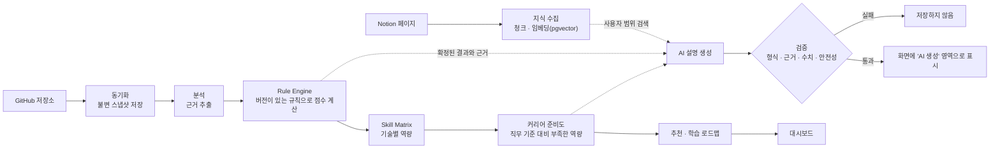
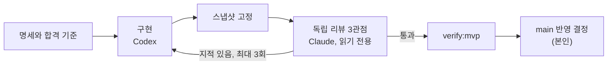

# DevPath

GitHub 저장소와 Notion 학습 기록을 근거로 개발자의 현재 역량과 다음 학습 단계를 보여 주는 서비스입니다.

커밋 수나 언어 비율로는 "이 프로젝트가 어떤 역량을 보여 주는가", "백엔드 개발자가 되려면 무엇이 부족한가"에 답하기 어렵습니다.
DevPath는 저장소를 그 시점 그대로 저장해 규칙으로 분석하고, 목표 직무 기준의 준비도와 학습 로드맵을 계산합니다.
점수는 정해진 규칙만 계산하고, AI는 계산된 결과를 근거와 함께 설명하는 역할만 맡습니다.

현재 상태: 로컬에서 동작하는 개인 프로젝트(MVP)입니다. 운영 배포는 하지 않았습니다.

## 제 역할

- 요구사항 명세, 점수 규칙 명세, 도메인·데이터 모델, API 명세, 아키텍처 결정 기록(ADR)을 직접 작성했습니다.
- 코드는 대부분 AI 코딩 에이전트가 작성했습니다. 구현은 Codex, 리뷰는 서로 맥락을 공유하지 않는 별도의 Claude 세션이 맡았습니다.
- 저는 이 에이전트들이 지킬 규칙과 검증 절차를 설계했습니다. 작업을 나누고, 작업마다 요구사항과 합격 기준을 정했습니다.
- 리뷰에서 나온 지적이 실제 결함인지 판단하고, 무엇을 고치고 무엇을 미룰지, 언제 main에 반영할지 직접 결정했습니다.

## 한눈에 보는 결과

| 항목 | 결과 |
|---|---|
| Backend 테스트 | 261개, 실패 0 (환경 조건부 건너뜀 2) — JUnit, 아키텍처 규칙, 실제 PostgreSQL 통합 테스트 포함 |
| Frontend 테스트 | 55개 파일, 261개 통과 (Vitest) |
| 브라우저 테스트 | Playwright 15개 통과, 각 화면에서 axe 접근성 검사(WCAG 2.1 AA 규칙) 위반 0 |
| 보안·의존성 | 보안 경계 검사 통과, `npm audit` 취약점 0 |
| API 계약 | OpenAPI 린트 오류 0 |
| 쿼리 개선 | 스냅샷 2개 목록 조회 SQL 18개 → 2개, 파일 500개 스냅샷 저장 SQL 3개 |

테스트 수치는 2026-10-26에 커밋 `f354132`에서 다시 실행한 결과입니다. 브라우저 테스트는 아래 [실행 방법](#실행-방법)의 포트 메모를 참고하세요.

## 화면

| 대시보드 | 기술 역량과 근거 상태 |
|---|---|
|  |  |
| **커리어 준비도 (목표 기준선 대비 막대)** | **분석 상세와 AI 설명 영역** |
|  |  |

화면의 데이터는 실제 사용자 데이터가 아니라 Playwright 테스트에 쓰는 샘플(테스트 fixture) 데이터입니다.
AI 영역은 "AI 생성 · 설명만 제공" 표시와 함께 공식 결과 아래에 따로 놓입니다.

## 구조와 설계

Backend는 Spring Boot 애플리케이션 하나 안에서 기능별 모듈을 나눈 구조(모듈러 모놀리스)입니다.
아래는 데이터가 흘러가는 순서입니다. AI 설명은 이 흐름 옆에서 확정된 결과를 읽기만 합니다.



동기화, 분석, 지식 수집, AI 생성처럼 오래 걸리는 일은 PostgreSQL에 저장된 작업(job)을 별도 워커가 가져가 처리합니다.

### 핵심 설계 결정

**1. 점수는 Rule Engine만 계산하고, AI는 설명만 한다** ([ADR-006](docs/18_ADR.md))
- 이유: LLM이 점수를 매기면 같은 입력에도 결과가 달라지고, 왜 그 점수인지 추적할 수 없습니다. 점수·준비도·추천 순서는 버전이 붙은 규칙(`readiness-v1`, `roadmap-v1` 등)으로 계산해, 같은 스냅샷과 같은 규칙 버전이면 같은 결과가 나옵니다.
- 한계: 규칙을 바꾸려면 새 버전을 만들어야 하고, 규칙에 없는 역량은 평가하지 못합니다. AI 문장은 자유도가 낮아집니다(아래 사례 2).

**2. 메시지 큐 대신 PostgreSQL 작업 테이블과 outbox** ([ADR-027](docs/18_ADR.md))
- outbox: 업무 데이터와 "보낼 이벤트"를 같은 트랜잭션으로 DB에 저장해, 둘 중 하나만 남는 상황을 막는 방식입니다.
- 이유: 혼자 운영하는 MVP에서 Kafka 같은 브로커를 추가하면 운영할 것이 늘어납니다. 작업이 DB에 있으면 API를 재시작해도 사라지지 않고, 상태를 SQL로 바로 조회할 수 있습니다.
- 트레이드오프: DB가 폴링 부하를 받고, 여러 워커가 같은 작업을 잡지 않게 하는 선점·재시도 로직을 직접 만들어야 합니다(아래 사례 3). 처리량이 커지면 브로커 도입을 다시 검토합니다.

**3. 벡터 검색은 별도 벡터 DB가 아닌 pgvector, 메타데이터 필터는 필수** ([ADR-028](docs/18_ADR.md))
- 이유: 검색 대상 문서가 사용자별로 엄격히 분리되어야 합니다. 같은 DB 안에서 사용자 ID, 연결 상태, 문서 상태, 임베딩 모델 조건으로 후보를 먼저 거른 뒤 거리를 계산하므로, 다른 사용자의 문서가 후보에 들어가지 않습니다.
- 트레이드오프: 벡터 검색이 업무 DB와 자원을 나눠 씁니다. 규모가 커지면 전용 벡터 DB로 옮기는 비용이 생깁니다. 그래서 검색은 포트(인터페이스) 뒤에 두었습니다.

**4. 헥사고날 구조의 모듈러 모놀리스** ([ADR-001, ADR-002](docs/18_ADR.md))
- 헥사고날 구조: 업무 규칙(domain)이 Spring, JPA, HTTP, 외부 API SDK를 모르게 하고, 바깥 기술은 어댑터로 연결하는 방식입니다.
- 이유: 서비스를 처음부터 쪼개면 배포와 데이터 정합성 비용이 기능보다 커집니다. 대신 경계를 엄격히 두고, 이 규칙을 ArchUnit 테스트로 빌드 때마다 확인합니다.
- 한계: 모듈 하나가 느려지면 전체 애플리케이션에 영향이 갑니다. 지금은 워커 실행 여부만 설정으로 나눕니다.

## 문제 해결 사례

### 1. 스냅샷 조회와 저장에서 SQL이 데이터 수만큼 늘어나던 문제

- 문제: 코드 점검에서 스냅샷 목록 화면이 스냅샷마다 하위 데이터(파일, 언어, 의존성 등)를 전부 불러오고, 스냅샷 저장은 행마다 SELECT 후 INSERT를 실행하는 것을 확인했습니다.
- 원인: 목록에는 개수만 필요한데 상세용 전체 조회를 재사용했습니다. 저장 쪽은 엔티티가 ID를 직접 만들기 때문에, JPA가 새 객체인지 모르고 매번 DB에서 먼저 조회(merge)했습니다.
- 해결: 목록은 헤더와 개수만 읽는 요약 쿼리 하나로 바꿨습니다. 저장은 엔티티가 `Persistable`로 "새 객체"임을 알려 주게 하고, JDBC 배치 INSERT를 켰습니다.
- 검증: Hibernate 통계로 SQL 수를 세는 PostgreSQL 통합 테스트를 만들고, 응답 내용이 바뀌지 않았는지 비교하는 테스트를 함께 두었습니다.
- 결과: 스냅샷 2개 목록 조회 SQL 18개 → 2개, 기술 화면 10개 → 4개. 파일 500개 스냅샷 저장은 SQL 3개로 끝납니다.

### 2. AI가 근거 없는 수치나 근거를 지어내지 못하게 하기

- 문제: AI 설명에 "테스트 점수가 85점입니다" 같은 문장이 들어가면, 사용자는 공식 점수와 AI가 만든 숫자를 구분할 수 없습니다.
- 원인: LLM은 입력에 없는 숫자나 존재하지 않는 근거 ID도 그럴듯하게 만들어 냅니다. 프롬프트로 "하지 마라"라고 쓰는 것만으로는 보장되지 않습니다.
- 해결: 생성 결과를 저장하기 전에 기능별 검증기(5종)를 통과하게 했습니다. 정해진 JSON 형식인지, 인용한 근거 ID가 실제 분석 근거에 있는지 확인하고, 설명 문장에 숫자가 있으면 추적할 수 없는 수치 주장으로 보고 거절합니다. HTML·스크립트나 시스템 프롬프트 노출도 거절합니다.
- 검증: 숫자, 없는 근거 ID, 위험한 HTML이 섞인 응답이 거절되는지 공통 정책 테스트와 검증기별 단위 테스트로 확인합니다.
- 결과: 검증을 통과하지 못한 응답은 저장되지 않고 화면에도 나오지 않습니다. 대신 AI 문장에는 숫자를 쓸 수 없다는 제약이 생겼습니다. 수치는 공식 결과 영역에서만 보여 줍니다.

### 3. 워커가 죽으면 AI 작업이 영원히 "실행 중"으로 남던 문제

- 문제: AI 생성 작업은 대기 상태(QUEUED)인 것만 가져가도록 되어 있었습니다. 워커가 작업 도중 죽으면 그 작업은 실행 중(RUNNING) 상태로 남아 다시 처리되지 않았습니다. 또 여러 워커가 같은 행의 잠금을 기다리며 줄을 섰습니다.
- 원인: 작업을 "언제까지 맡는지"에 대한 기한(lease)이 없었고, 선점 쿼리가 잠긴 행을 건너뛰지 않았습니다.
- 해결: 작업에 15분 기한과 다음 시도 시각을 두었습니다. 기한이 지난 작업은 다른 워커가 다시 가져가고, 재시도 간격은 30초부터 최대 5분까지 늘어나며, 시도 한도를 넘으면 실패로 끝냅니다. 선점 쿼리는 이미 잠긴 행을 건너뛰도록 바꿨습니다.
- 검증: 기한 만료 후 재선점, 시도 한도 초과 시 실패, 오래된 시도가 나중에 결과를 덮어쓰지 못하는지를 테스트했습니다. 가장 오래된 작업이 잠겨 있을 때 다음 작업을 기다리지 않고 가져가는지도 분석·동기화·AI 각각 PostgreSQL 통합 테스트로 확인합니다.
- 결과: 워커 장애가 나도 작업이 멈춘 채 남지 않습니다. 같은 요청이 두 번 들어오는 경우는 별도로 요청 키(idempotency key)로 막아, 다른 요청에 같은 키를 쓰면 `409 DUPLICATE_REQUEST`를 돌려줍니다.

## 결과물 검증 방법

AI가 쓴 코드를 믿으려면 "작성한 쪽이 아닌 쪽"이 확인해야 한다고 보고 아래 절차를 만들었습니다.

- 구현은 Codex, 리뷰는 별도의 Claude 세션 3개가 서로 다른 관점으로 읽기 전용으로 합니다: 기능·명세 충족 / 보안·데이터 일관성(UI 작업은 접근성·디자인) / 코드 리뷰.
- 리뷰는 diff 해시로 고정한 스냅샷만 대상으로 하고, 리뷰-수정 사이클은 최대 3회입니다. 3회 안에 통과하지 못하면 반영하지 않고 멈춥니다.
- 자동 검증: Rule Engine 결정론 골든 테스트(`fixtures/rule-engine`의 고정 입력과 기대 결과), Testcontainers로 띄운 실제 PostgreSQL(pgvector) 통합 테스트, ArchUnit 구조 규칙, OpenAPI 계약 린트, Playwright와 axe 접근성 검사.
- 테스트만 추가하는 작업은 뮤테이션 증거를 요구합니다. 대상 코드를 일부러 망가뜨려 새 테스트가 실패하는 것을 보이고, 되돌린 뒤 diff에 테스트만 남았는지 확인합니다.
- 반영 전 마지막 관문은 `npm run verify:mvp` 한 번입니다.



리뷰가 구현자가 놓친 결함을 잡은 예: 사례 1의 저장 개선에서 구현자는 `Persistable.isNew()`가 항상 `true`를 돌려주게 만들었습니다.
테스트는 모두 통과했지만, 리뷰에서 DB에서 불러온 엔티티까지 새 객체로 취급되어 삭제·재저장이 잘못 동작할 수 있다는 지적이 나왔습니다.
불러오거나 저장한 뒤에는 꺼지는 상태 플래그로 고치고, 불러온 객체의 `isNew()`와 재수집 후 청크 상태를 검증하는 테스트를 추가했습니다(커밋 `5301e2d`).

에이전트 역할과 절차의 자세한 규칙은 [AGENT.md](AGENT.md)에 있습니다.

## 실행 방법

필요한 것: JDK 21, Node.js 20.19 이상 또는 22.12 이상, Docker(테스트용 PostgreSQL 컨테이너), GitHub OAuth App.
로컬 실행에는 pgvector 확장을 쓸 수 있는 PostgreSQL이 필요합니다. Notion과 AI 기능을 쓰려면 Notion integration과 로컬 Ollama(`http://localhost:11434`)가 추가로 필요합니다.

전체 검증(저장소 루트):

```text
npm run verify:mvp
```

Docker 확인, 보안 경계 검사, backend clean build와 테스트, frontend 설치·테스트·브라우저 테스트·빌드·`npm audit`, OpenAPI 린트를 차례로 실행합니다.
포트 메모: 브라우저 테스트용 개발 서버는 4173 포트로 고정되어 있습니다. Windows에서 이 포트가 시스템 예약 범위에 들어가면 이 단계가 실행되지 않습니다. 2026-10-26 실행에서 이 문제가 있어, 같은 테스트를 다른 포트에서 따로 실행해 15개 통과를 확인했습니다.

로컬 실행:

```powershell
# Backend (local 프로필: DB 기본값 localhost:15432/devpath)
$env:SPRING_PROFILES_ACTIVE = "local"
cd backend
.\gradlew.bat bootRun
```

```powershell
# Frontend
cd frontend
npm ci
npm run dev
```

| 대상 | 기본 주소 |
|---|---|
| Frontend | `http://localhost:5100` |
| Backend | `http://localhost:8080` |
| GitHub OAuth callback | `http://localhost:8080/login/oauth2/code/github` |

Backend 포트를 바꾸면(예: `SERVER_PORT=18080`) frontend의 `VITE_DEVPATH_API_BASE_URL`과 OAuth callback 주소도 같은 포트로 맞춰야 합니다.
환경 변수 예시는 `backend/.env.example`과 `frontend/.env.example`에 있습니다. Spring Boot는 `.env.example`을 읽지 않으므로, 값을 프로세스 환경 변수로 넘기거나 `backend/.env`로 복사해 두면 `bootRun`이 비어 있는 변수만 채웁니다.

## 한계와 다음 단계

- 운영 배포는 하지 않았습니다. 배포 플랫폼, 운영 시크릿 관리, 운영 관측 도구는 아직 결정하지 않은 상태(ADR-031, 033, 034 Proposed)라 손대지 않았습니다.
- Notion 검색과 AI 설명은 자동 테스트에서 테스트용 대체 서버·대체 구현과 실제 PostgreSQL로 검증했습니다. 실제 Notion 워크스페이스와 로컬 Ollama 모델로 하는 점검과 그에 따른 최종 승인은 아직 남아 있습니다.
- 기업별 준비도 보정, 생성 결과 목록·재시도·편집·내보내기, 포트폴리오·이력서·면접 준비 문서 생성, 관리자 기능은 구현하지 않았습니다.
- 스크린 리더와 200% 확대 수동 점검은 하지 않았습니다. 이력 조회 API에는 아직 페이지 나누기가 없습니다.

## 문서

- [docs/01_SRS.md](docs/01_SRS.md) — 요구사항 명세
- [docs/02_Rule_Engine.md](docs/02_Rule_Engine.md) — 점수 규칙 명세
- [docs/18_ADR.md](docs/18_ADR.md) — 기술 결정 기록
- [docs/21_Feature_Status.md](docs/21_Feature_Status.md) — 기능별 구현 상태와 검증 기록
