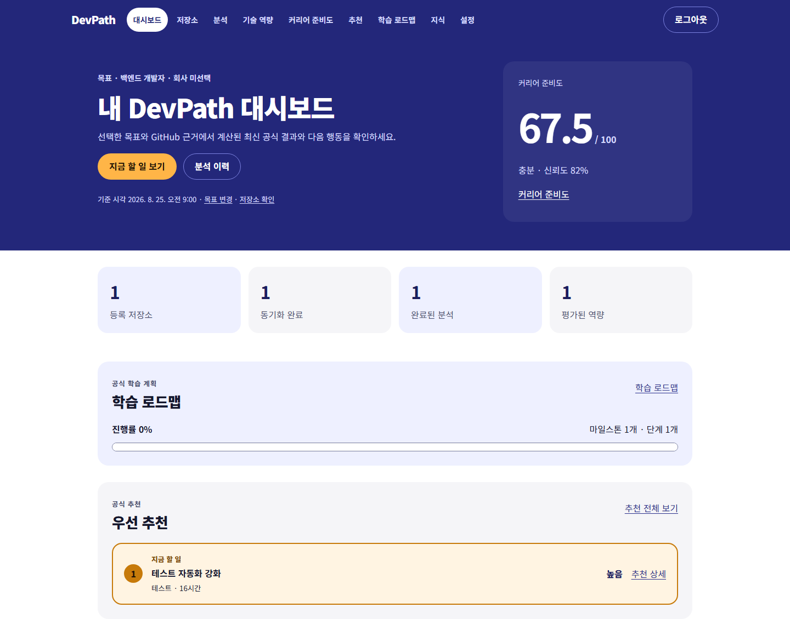
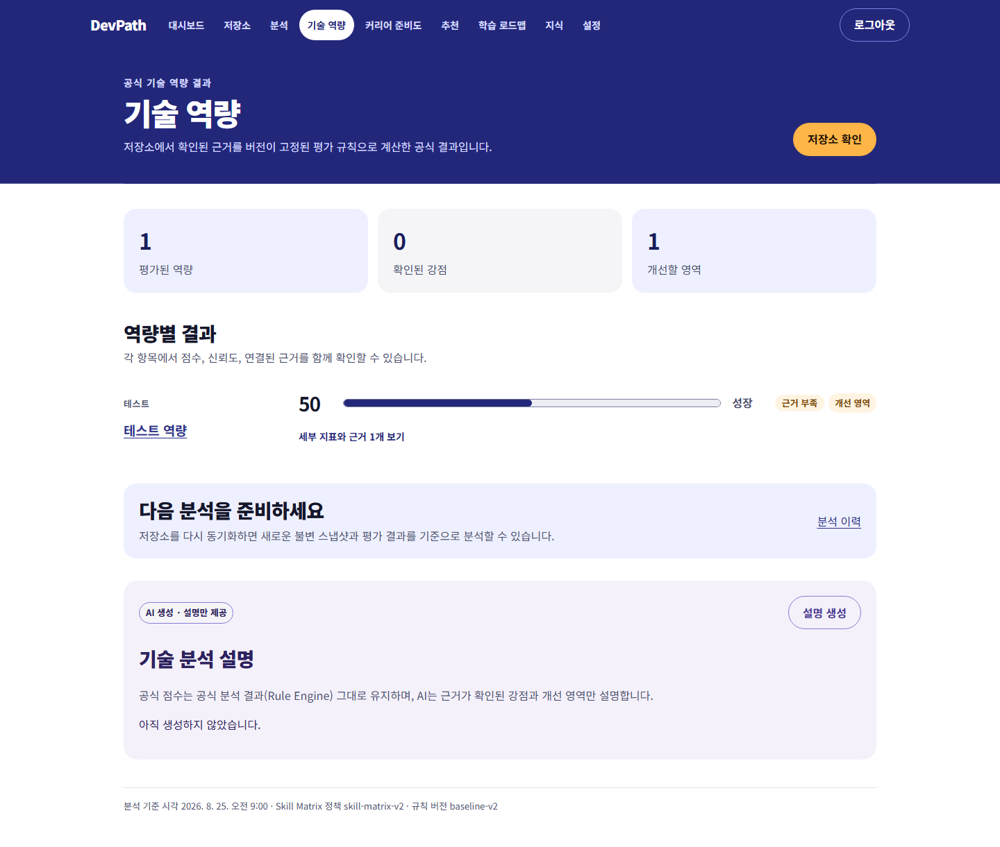
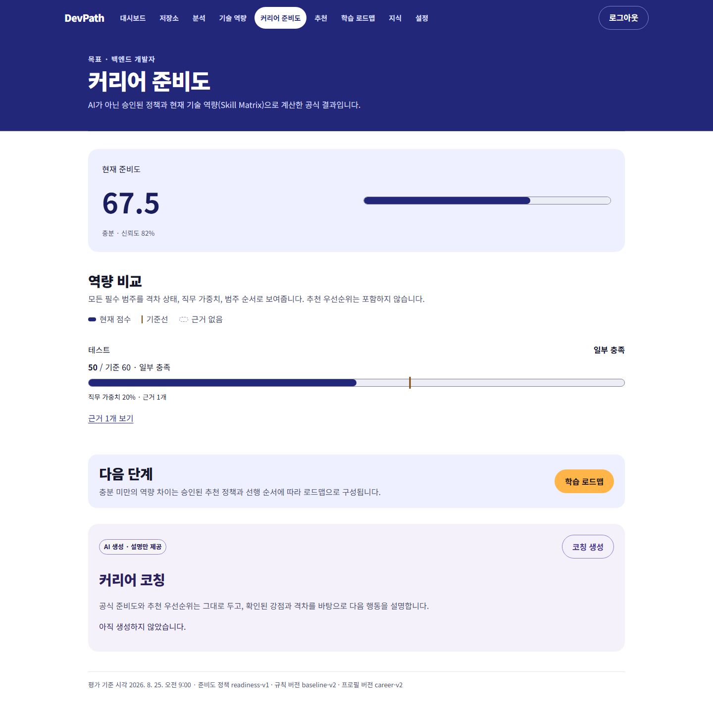
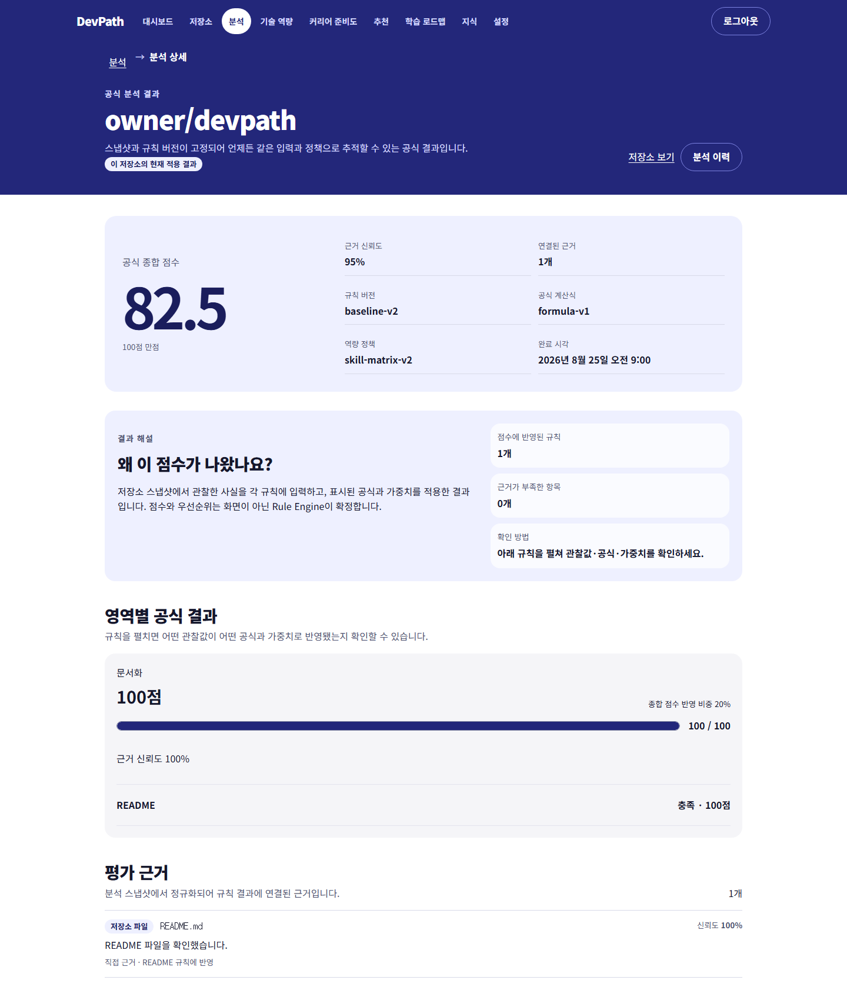
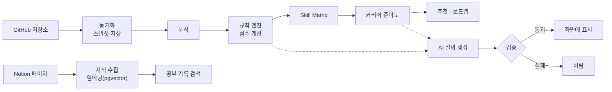

# DevPath

내 GitHub 저장소를 분석해서 지금 어떤 역량이 있고 다음에 뭘 공부하면 좋을지 알려 주는 서비스입니다. Notion에 정리한 공부 기록도 모아서 검색할 수 있습니다.

## 만들게 된 이유

취업 준비를 하면서 "내 프로젝트들이 백엔드 개발자로서 어느 정도 수준인지", "뭐가 부족한지"를 스스로 판단하기가 어려웠습니다.
GitHub 잔디나 언어 비율 같은 통계는 많은데, 그걸로는 실제 역량을 알기 어렵다고 느꼈습니다.
그래서 저장소를 분석해서 직무 기준으로 부족한 부분을 보여 주고, 학습 순서까지 추천해 주는 서비스를 만들어 보기로 했습니다.

처음부터 정한 원칙이 하나 있습니다. 점수는 정해진 규칙으로만 계산하고, AI는 그 결과를 설명하는 데만 씁니다.
AI가 점수를 매기면 같은 저장소인데도 결과가 매번 달라질 수 있고, 왜 그 점수가 나왔는지 설명할 수 없기 때문입니다.

지금은 로컬에서 돌아가는 개인 프로젝트(MVP) 단계이고, 아직 배포는 하지 않았습니다.

## 주요 기능

- GitHub 저장소를 연결하면 그 시점의 저장소 상태를 스냅샷으로 저장하고 분석합니다.
- 규칙 엔진이 테스트, 구조, 문서화 같은 항목별 점수와 근거를 계산합니다.
- 기술별 역량(Skill Matrix)을 만들고, 근거가 부족한 기술은 따로 표시합니다.
- 목표 직무(백엔드, 프론트엔드)를 고르면 직무 기준과 비교한 준비도를 보여 줍니다.
- 부족한 부분을 바탕으로 추천과 학습 로드맵을 만들어 줍니다.
- Notion에 정리한 공부 기록을 가져와서 내용 기반으로 검색할 수 있습니다(pgvector).
- AI 설명(저장소 요약, 리뷰, 커리어 코칭 등)은 공식 결과와 구분되는 영역에 따로 보여 줍니다.

## 화면

| 대시보드 | 기술 역량 |
|---|---|
|  |  |
| 커리어 준비도 | 분석 상세 |
|  |  |

캡처에 나온 데이터는 테스트용 샘플 데이터입니다.

## 기술 스택

| 구분 | 사용 기술 |
|---|---|
| Backend | Java 21, Spring Boot 3.3, Spring Data JPA, Flyway |
| Frontend | React 18, TypeScript, Vite, React Query |
| DB | PostgreSQL, pgvector |
| AI | Ollama (로컬 LLM, 임베딩) |
| 테스트 | JUnit, Testcontainers, ArchUnit, Vitest, Playwright, axe |

## 구조

Spring Boot 애플리케이션 하나 안에서 기능별로 모듈을 나눈 모듈러 모놀리스 구조로 만들었습니다.
처음에는 서비스를 나누는 것도 고민했는데, 혼자 만드는 프로젝트에서는 배포나 데이터 맞추는 일이 기능 개발보다 더 커질 것 같아서 하나로 두고 모듈 경계만 엄격하게 지키기로 했습니다.
도메인 코드가 Spring이나 JPA에 의존하지 않도록 헥사고날 구조를 썼고, 이 규칙은 ArchUnit 테스트로 빌드할 때마다 검사합니다.



설계하면서 고민했던 부분은 이렇습니다.

- **작업 큐를 따로 두지 않고 PostgreSQL 테이블로 처리했습니다.**
  동기화, 분석, AI 생성은 시간이 걸려서 비동기로 처리해야 했습니다. Kafka 같은 메시지 큐도 생각했지만, 혼자 운영하기에는 관리할 게 너무 많아질 것 같았습니다. 작업을 DB에 저장해 두면 서버가 재시작돼도 작업이 사라지지 않고, SQL로 상태를 바로 볼 수 있다는 점도 좋았습니다. 대신 여러 워커가 같은 작업을 가져가지 않게 하는 처리를 직접 만들어야 했습니다(아래 트러블슈팅 3번).
- **벡터 검색은 별도 벡터 DB 대신 pgvector를 썼습니다.**
  Notion 문서는 사용자마다 철저히 분리되어야 합니다. 같은 DB 안에서 사용자 ID 같은 조건으로 먼저 거른 다음 검색하면 다른 사람 문서가 섞일 일이 없어서 이 방식을 골랐습니다.
- **규칙에는 버전을 붙였습니다.**
  `readiness-v1`, `skill-matrix-v3`처럼 버전을 두고, 규칙을 바꿀 때는 새 버전을 만듭니다. 그래서 예전 분석 결과도 당시 규칙 그대로 다시 확인할 수 있습니다.

## 트러블슈팅

### 1. 스냅샷 목록 하나 보는데 SQL이 18번 나가던 문제

스냅샷 목록 화면을 점검하다가 쿼리가 너무 많이 나가는 걸 발견했습니다. 목록에는 파일 개수 정도만 필요한데, 상세 화면용 조회를 그대로 써서 스냅샷마다 파일, 언어, 의존성 데이터를 전부 불러오고 있었습니다.
저장할 때도 문제가 있었습니다. 엔티티 ID를 직접 만들다 보니 JPA가 새 데이터인지 판단하지 못해서, 행마다 SELECT를 한 번씩 하고 나서 INSERT를 하고 있었습니다.

목록은 개수만 세는 요약 쿼리로 바꿨고, 저장은 `Persistable`을 구현해서 새 엔티티라는 걸 알려 주고 배치 INSERT를 켰습니다.
Hibernate 통계로 SQL 개수를 세는 통합 테스트를 만들어서 확인했고, 스냅샷 2개 목록 조회가 SQL 18개에서 2개로 줄었습니다. 파일 500개짜리 스냅샷 저장도 SQL 3개로 끝납니다.

여기서 하나 더 배운 게 있습니다. 처음에는 `isNew()`가 항상 `true`를 반환하게 만들었는데 테스트는 다 통과했습니다. 그런데 리뷰에서 DB에서 불러온 엔티티까지 새 데이터로 취급하면 삭제나 재저장이 잘못될 수 있다는 지적을 받았습니다. 불러오거나 저장한 뒤에는 `false`가 되도록 고치고, 그 경우를 확인하는 테스트도 추가했습니다. 테스트가 통과했다고 끝난 게 아니라는 걸 느낀 경험이었습니다.

### 2. AI가 없는 숫자를 지어내는 문제

AI 설명에 "테스트 점수가 85점입니다" 같은 문장이 나오면, 사용자 입장에서는 그게 공식 점수인지 AI가 만든 숫자인지 알 수 없습니다. 프롬프트에 "숫자를 지어내지 마"라고 써도 완전히 막을 수는 없었습니다.

그래서 AI 응답을 저장하기 전에 검증하는 단계를 넣었습니다. 정해진 JSON 형식인지, 인용한 근거가 실제로 있는 근거인지 확인합니다. 설명 문장에 숫자가 들어가 있거나 HTML, 스크립트가 섞여 있으면 거절합니다.
검증을 통과하지 못한 응답은 저장도 안 되고 화면에도 안 나옵니다. 대신 AI 설명에는 숫자를 쓸 수 없게 됐는데, 숫자는 공식 결과 쪽에서만 보여 주면 된다고 판단했습니다.

### 3. 워커가 죽으면 작업이 계속 "실행 중"으로 남던 문제

AI 생성 작업을 처리하던 워커가 중간에 죽으면, 그 작업은 "실행 중" 상태로 계속 남아서 다시 처리되지 않았습니다. 워커는 "대기 중"인 작업만 가져가도록 되어 있었기 때문입니다.

작업마다 15분짜리 기한(lease)을 두고, 기한이 지나면 다른 워커가 다시 가져갈 수 있게 바꿨습니다. 재시도 간격은 30초부터 시작해서 최대 5분까지 늘어나고, 정해진 횟수를 넘으면 실패로 처리합니다.
여러 워커가 같은 작업을 잡으려고 줄 서서 기다리는 문제도 있어서, 이미 잠긴 작업은 건너뛰고 다음 작업을 가져가도록 PostgreSQL의 `SKIP LOCKED`를 쓰게 바꿨습니다.
실제 PostgreSQL을 띄우는 통합 테스트로 기한 만료 후 다시 가져가는지, 오래된 시도가 나중에 결과를 덮어쓰지 않는지 확인했습니다.

## 개발 방식

이 프로젝트는 AI 코딩 에이전트를 적극적으로 활용해서 만들었습니다.
처음에는 에이전트에게 맡기면 빨리 끝날 줄 알았는데, 막상 해 보니 결과물을 믿을 수 있게 만드는 게 더 어려웠습니다. 그래서 에이전트가 실수하기 어렵고, 실수하면 바로 드러나는 작업 환경을 만드는 데 시간을 많이 썼습니다.

- **작업 전에 명세부터 썼습니다.** 기능마다 요구사항, 점수 규칙, API 계약(OpenAPI), 합격 기준을 먼저 정하고, 작업 하나에는 수정할 파일 범위와 돌려야 할 테스트를 적어서 넘겼습니다.
- **규칙은 테스트로 강제했습니다.** 계층 간 의존 규칙(ArchUnit), CSS 색상 하드코딩 금지, 비밀값 노출 검사처럼 지켜야 하는 규칙은 말로만 두지 않고 테스트로 만들었습니다. 전체 검사는 `npm run verify:mvp` 한 번으로 돌아갑니다.
- **구현과 리뷰를 분리했습니다.** 구현한 에이전트와 다른 세션 3개가 기능, 데이터·보안(화면 작업은 접근성), 코드 품질을 각각 따로 리뷰하게 했습니다. 지적이 나오면 고쳐서 다시 리뷰받고, 3번 안에 통과하지 못하면 반영하지 않았습니다.
- **테스트도 검증했습니다.** 테스트만 추가하는 작업은 대상 코드를 일부러 망가뜨렸을 때 테스트가 실제로 실패하는지까지 확인했습니다.
- **반영은 직접 판단했습니다.** 리뷰에서 나온 지적이 진짜 문제인지 코드를 보고 확인한 다음, 고칠지 미룰지와 main에 반영할지를 정했습니다.

운영하면서 고친 점도 있습니다. 프로젝트 상태를 여러 문서에 나눠 적어 뒀더니 문서마다 DB 마이그레이션 버전이 V1, V28, V30으로 달라져 있었습니다. 에이전트가 어떤 문서를 읽느냐에 따라 다른 정보를 믿을 수 있는 상황이라, 상태는 한 문서에서만 관리하도록 정리했습니다.
에이전트에게 긴 지시를 터미널로 붙여 넣으면 입력이 제출되지 않고 멈추는 일도 자주 있었습니다. 그래서 지시는 짧게 쓰고 자세한 내용은 파일로 넘기는 방식으로 바꿨습니다.

## 테스트

2026-10-26 기준 결과입니다.

- Backend: 261개 통과 (환경에 따라 건너뛰는 테스트 2개). 실제 PostgreSQL을 띄우는 통합 테스트 포함
- Frontend: 261개 통과 (Vitest)
- E2E: Playwright 15개 통과, 화면마다 axe 접근성 검사 통과
- `npm audit` 취약점 0개, OpenAPI 린트 오류 0개

규칙 엔진은 고정된 입력에 대해 항상 같은 점수가 나오는지 확인하는 골든 테스트(`fixtures/rule-engine`)로 검사합니다.

## 실행 방법

필요한 것: JDK 21, Node.js 20.19 이상, Docker, GitHub OAuth App
Notion과 AI 기능까지 쓰려면 Notion integration과 로컬 Ollama(`http://localhost:11434`)가 필요합니다.

전체 테스트와 빌드는 저장소 루트에서 아래 명령 하나로 돌릴 수 있습니다.

```text
npm run verify:mvp
```

로컬 실행:

```powershell
# Backend (local 프로필, DB 기본값 localhost:15432/devpath)
$env:SPRING_PROFILES_ACTIVE = "local"
cd backend
.\gradlew.bat bootRun
```

```powershell
# Frontend
cd frontend
npm ci
npm run dev
```

| 대상 | 주소 |
|---|---|
| Frontend | `http://localhost:5100` |
| Backend | `http://localhost:8080` |
| GitHub OAuth callback | `http://localhost:8080/login/oauth2/code/github` |

Backend 포트를 바꾸면(예: `SERVER_PORT=18080`) frontend의 `VITE_DEVPATH_API_BASE_URL`과 OAuth callback 주소도 같이 바꿔야 합니다.
환경 변수 예시는 `backend/.env.example`, `frontend/.env.example`에 있습니다.

참고로 Windows에서는 E2E 테스트용 4173 포트가 시스템 예약 범위에 들어가서 실행이 안 될 때가 있습니다. 이 부분은 포트를 설정으로 바꿀 수 있게 고칠 예정입니다.

## 아쉬운 점과 앞으로 할 것

- 아직 배포를 하지 못했습니다. 배포 환경과 운영용 비밀값 관리 방법을 정하는 게 다음 목표입니다.
- Notion 검색과 AI 설명은 테스트용 대체 서버로 검증했고, 실제 Notion 워크스페이스와 Ollama 모델로 충분히 써 보는 건 아직 남아 있습니다.
- Notion 공부 기록은 지금은 검색만 됩니다. 이 기록을 AI 설명이나 역량 평가에 연결하는 건 다음에 해 보고 싶은 부분입니다.
- 기업별 준비도, 포트폴리오·이력서 생성, 관리자 기능은 처음에 계획했지만 아직 만들지 못했습니다.
- 스크린 리더로 직접 써 보는 테스트는 아직 하지 않았습니다.

## 문서

- [요구사항 명세](docs/SRS.md)
- [점수 규칙](docs/SCORING_RULES.md)
- [기술 결정 기록(ADR)](docs/ADR.md)
- [기능별 구현 상태](docs/STATUS.md)
