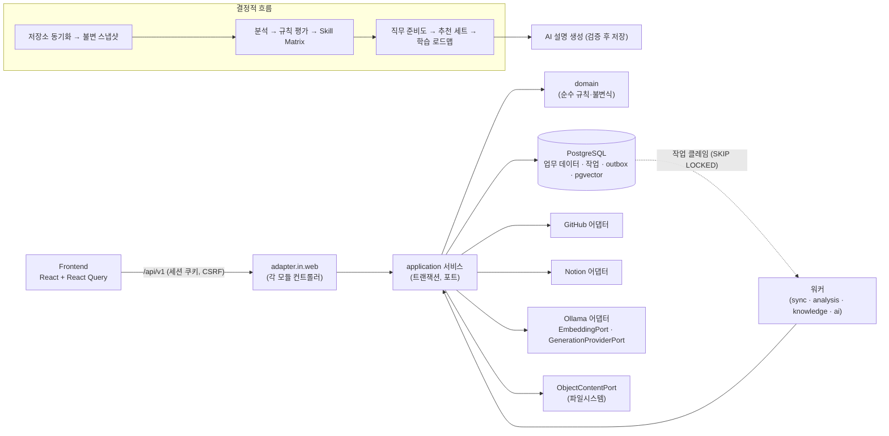

# DevPath 아키텍처

이 문서는 DevPath의 실제 구현 구조를 설명한다. 요구사항은 [docs/SRS.md](SRS.md), 점수 공식과 정책 버전은 [docs/SCORING_RULES.md](SCORING_RULES.md), 보안 규칙은 [docs/SECURITY.md](SECURITY.md), 기술 결정은 [docs/ADR.md](ADR.md), 구현 현황은 [docs/STATUS.md](STATUS.md)를 본다. API의 기계 판독 원본은 `contracts/openapi/devpath-openapi.yaml`이다.

## 1. 시스템 개요

DevPath는 GitHub 저장소와 Notion 문서를 근거로 개발자의 기술 성장을 평가하는 서비스다. 공식 점수는 결정적 Rule Engine만 계산한다. AI는 저장된 엔진 결과를 설명하는 글만 만들고, 검증을 통과한 결과만 저장한다.

구성은 다음과 같다.

| 구성 | 기술 |
|---|---|
| 백엔드 | Java 21, Spring Boot 3.3.5, 모듈형 모놀리스, 헥사고날 경계 |
| 프론트엔드 | React 18, TypeScript, Vite, React Router, React Query (TanStack Query 5) |
| 스타일 | 일반 CSS (`frontend/src/app/styles/*.css`, 토큰은 `tokens.css`) |
| 데이터 | PostgreSQL 16 + pgvector, Spring Data JPA/JDBC, Flyway (V1~V30) |
| 인증 | GitHub OAuth2 로그인, Spring Session JDBC 서버 세션, CSRF, 단일 origin CORS |
| 비동기 작업 | PostgreSQL 작업 테이블 + 트랜잭션 outbox (메시지 브로커 없음) |
| AI·임베딩 | Ollama (생성 `qwen2.5:7b`, 임베딩 `nomic-embed-text` 768차원), provider 포트 뒤에 둠 |
| 객체 저장 | `ObjectContentPort` + 파일시스템 어댑터 (로컬/테스트 전용) |



핵심 흐름:

1. 사용자가 GitHub로 로그인하고 GitHub App·Notion을 연결한다.
2. 저장소를 가져와 동기화하면 워커가 GitHub에서 수집해 불변 스냅샷을 만든다.
3. 분석 요청 시 워커가 Rule Engine으로 규칙 평가와 Skill Matrix를 만든다. 같은 작업 안에서 선택된 직무가 있으면 직무 준비도, 추천 세트, 학습 로드맵이 이어서 생성된다 (`AnalysisWorker`).
4. 사용자가 AI 설명을 요청하면 저장된 결과로 프롬프트 컨텍스트를 만들고, 워커가 Ollama를 호출한 뒤 검증을 통과한 결과만 산출물로 저장한다.
5. Notion 페이지는 별도로 수집·청크·임베딩되어 사용자 범위 의미 검색에 쓰인다. 현재 AI 생성 컨텍스트에는 지식 검색 결과가 들어가지 않는다.

## 2. 백엔드 구조

### 2.1 패키지 구조

모든 코드는 `com.devpath.<module>` 아래에 있고, 모듈 안은 다음 계층으로 나뉜다.

| 패키지 | 역할 |
|---|---|
| `domain` | 업무 개념과 불변식. Spring, JPA, HTTP, provider SDK에 의존하지 않는다. |
| `application` | 유스케이스, 트랜잭션, 포트(인터페이스), 뷰 레코드 |
| `adapter.in.web` | REST 컨트롤러, 모듈별 예외 처리 advice |
| `adapter.in.security` | 인증 핸들러 (identity 모듈) |
| `adapter.out.persistence` | JPA 엔티티·리포지토리, JDBC 어댑터 |
| `adapter.out.<provider>` | `github`, `notion`, `embedding`, `generation`, `security`(토큰 암호화) |
| `config` | 프레임워크 설정, 프로퍼티 바인딩, 워커 스케줄러 |

모든 모듈이 모든 계층을 가지지는 않는다. 예: `prompt`는 `application`만, `audit`은 `adapter.out.persistence`만, `platform`은 `health`만 있다.

### 2.2 모듈 목록

| 모듈 | 책임 |
|---|---|
| `identity` | GitHub OAuth2 로그인, 사용자·프로필·목표(직무/회사) 선호, 세션·CSRF·CORS 설정 (`SecurityConfiguration`) |
| `integration` | GitHub App·Notion 사용자 인증, provider API 어댑터, provider 토큰 암호화 저장, Notion 워크스페이스·페이지 메타데이터 |
| `repository` | 저장소 가져오기·보관·복원, 동기화 작업, 불변 스냅샷, 기술·엔지니어링 증거·활동 타임라인 추출 |
| `analysis` | 분석 작업과 결과, 분석 이력·비교, 분석 완료 후 준비도·추천 생성 연결 |
| `rule` | Rule Engine: 버전 관리되는 규칙 카탈로그, 규칙 평가, 점수 분해, Skill Matrix |
| `career` | 직무 카탈로그, 직무 준비도, 스킬 갭 |
| `company` | 회사 카탈로그 조회 (회사별 평가는 미구현) |
| `recommendation` | 추천 세트와 학습 로드맵 생성·저장·조회 |
| `learning` | 학습 로드맵 도메인과 API (저장은 `recommendation` 모듈 영속 어댑터) |
| `knowledge` | Notion 문서 수집 작업, 청크, 임베딩, 의미 검색, 검색 기록 |
| `prompt` | AI 작업별 프롬프트 빌더, 템플릿 버전, 비밀 정보 탐지 |
| `ai` | 생성 작업, Ollama 생성 어댑터, 출력 검증, 생성 산출물 저장 |
| `dashboard` | 대시보드 요약 (원본 결과의 읽기 전용 조합) |
| `onboarding` | 온보딩 진행 상황 투영 (점수 계산 없음) |
| `audit` | 감사 기록 저장 어댑터 (`DurableAuditRecordAdapter`가 각 모듈의 `*AuditPort` 구현) |
| `platform` | `GET /internal/health` |
| `shared` | `api`: 응답 envelope, 요청/상관 ID 필터, 공통 검증 예외 처리 · `application`: `DuplicateRequestException`, `ObjectContentPort` · `infrastructure`: 파일시스템 객체 저장, 워커 종료 게이트 |

### 2.3 계층 규칙

`ArchitectureBoundaryTest`(ArchUnit)가 다음을 강제한다.

| 규칙 | 내용 |
|---|---|
| 도메인 순수성 | `..domain..`은 `org.springframework..`, `jakarta.persistence..`, provider SDK 패키지에 의존하지 않는다. |
| 도메인 → 어댑터 금지 | `..domain..`은 `..adapter..`에 의존하지 않는다. |
| 인바운드 → 아웃바운드 금지 | `..adapter.in..`은 `..adapter.out..`에 의존하지 않는다. |
| 웹 → JPA 금지 | `..adapter.in.web..`은 JPA와 `..adapter.out.persistence..`에 의존하지 않는다. 컨트롤러는 리포지토리를 직접 쓰지 않는다. |
| 모듈 간 어댑터 금지 | 모듈 어댑터는 다른 모듈의 어댑터를 import하지 않고 application 경계로 통신한다 (현재 `identity` 어댑터 기준으로 검사). |

그 밖의 규칙:

- 트랜잭션은 application 서비스가 소유한다. 외부 호출(GitHub, Notion, Ollama)은 긴 DB 트랜잭션 밖에서 한다. 워커는 클레임 트랜잭션 → provider 호출 → 결과 저장 트랜잭션 순서로 나눈다.
- 스키마는 Flyway만 바꾼다. 런타임은 `spring.jpa.hibernate.ddl-auto=validate`다.
- provider 페이로드와 SDK 타입은 도메인, application 계약, 공개 API에 들어가지 않는다.
- 영속 모델(JPA 엔티티)과 도메인 모델(record)은 분리한다.

## 3. 프론트엔드 구조

### 3.1 폴더

| 경로 | 내용 |
|---|---|
| `src/app/` | `App`, `AppLayout`(공통 셸), `AppProviders`(QueryClient), `ErrorBoundary`, 스타일 |
| `src/routes/AppRoutes.tsx` | React Router 라우트 정의와 라우트 오류 경계 |
| `src/pages/` | 화면 단위 페이지 컴포넌트 |
| `src/features/<feature>/` | `api`(엔드포인트 호출), `model`(React Query 훅·타입), `ui`(기능 전용 컴포넌트) |
| `src/shared/api/apiClient.ts` | `fetch` 래퍼, `ApiError`, `NetworkError`, CSRF 헬퍼 |
| `src/shared/ui/` | 공통 UI (`PageState`, `ConfirmDialog`, `EvidenceItem`, `StatusChip`, `labels` 등) |

기능 폴더: `ai`, `analysis`, `careers`, `companies`, `connections`, `dashboard`, `knowledge`, `onboarding`, `profile`, `readiness`, `recommendations`, `repositories`, `session`, `settings`, `skills`.

### 3.2 규칙

| 항목 | 구현 |
|---|---|
| 서버 상태 | React Query가 소유한다. 기본값 `retry: false`, `refetchOnWindowFocus: false`. |
| 세션 부트스트랩 | `GET /api/v1/users/me` (`useSession`, 쿼리 키 `["session","current-user"]`). |
| 401 vs 네트워크 오류 | `401`은 익명 상태로 처리한다 (`getCurrentUser`가 `null` 반환). `fetch` 실패는 `NetworkError`로 따로 구분해 다른 화면 상태로 보여 준다 (`PageState`). |
| 요청 공통 | `credentials: "include"`, 요청마다 새 `X-Request-Id`, 브라우저 세션 단위 `X-Correlation-Id`. |
| CSRF | 상태 변경 요청 전에 `GET /api/v1/csrf`로 토큰을 받아 응답의 `headerName`(`X-CSRF-TOKEN`)으로 보낸다 (`withCsrf`). |
| 오류 표시 | `ApiError`는 `status`, `code`, 요청/상관 ID, `Retry-After`, `X-RateLimit-Reset`을 보존한다. 429는 재시도 시각 안내를 만든다. |
| 공식 결과 | UI는 점수, 준비도, 추천 우선순위를 계산하지 않고 API 값을 그대로 보여 준다. provider를 직접 호출하지 않는다. |
| API 주소 | `VITE_DEVPATH_API_BASE_URL` (기본 `http://localhost:8080`). |

화면 디자인, 상태 표시, 접근성 규칙은 [DESIGN.md](../DESIGN.md)를 따른다.

## 4. 도메인·데이터 모델

### 4.1 용어집

| 용어 | 뜻 |
|---|---|
| User | GitHub 로그인으로 만든 DevPath 계정. 모든 개인 데이터의 소유자. |
| ConnectedAccount | GitHub App 또는 Notion 연결. 상태 `ACTIVE`/`EXPIRED`/`REVOKED`. |
| Repository | GitHub에서 가져온 저장소. 수명 상태 `DISCOVERED`/`ACTIVE`/`ARCHIVED`/`DELETED_EXTERNALLY`. |
| RepositorySnapshot | 동기화 시점의 저장소 상태. `READY`가 되면 불변. |
| Technology | 언어·프레임워크·데이터베이스 같은 도구. 스냅샷에서 추출한다. |
| Evidence | 점수·평가·추천을 뒷받침하는 추적 가능한 관측 사실. |
| Rule / RuleSetVersion | Rule Engine의 결정적 평가 정의와 그 버전 묶음. |
| RuleEvaluation | 스냅샷 하나에 대한 규칙 평가 결과. 완료 후 불변. |
| Skill Matrix | 규칙 평가에서 만든 스킬별 점수·수준·근거 상태. |
| Career / CareerProfileVersion | 지원 직무와 그 버전별 기대 역량. |
| Career Readiness | Skill Matrix를 직무 프로필과 비교한 결정적 결과와 스킬 갭. |
| Company / CompanyProfileVersion | 지원 회사와 그 버전별 강조점 (조회만 구현). |
| Recommendation / RecommendationSet | 스킬 갭에서 나온 결정적 우선순위의 행동 제안과 그 묶음. |
| Learning Roadmap | 추천 세트에서 만든 마일스톤·단계 학습 계획. |
| KnowledgeDocument / Version / Chunk | 수집한 Notion 문서, 그 버전, 검색 단위 조각. |
| EmbeddingRecord | 청크의 벡터와 provider·모델·차원 메타데이터. |
| PromptTemplateVersion | 작업 유형별 버전 관리 프롬프트 템플릿. |
| PromptContext | AI 작업 1건을 위해 만든 불변 컨텍스트 (해시 포함). |
| Generated Artifact | 검증을 통과한 AI 결과와 출처 정보. 증거가 아니다. |

구분할 개념:

| 개념 | 차이 |
|---|---|
| Evidence ≠ Score | 증거는 관측 사실, 점수는 규칙과 증거로 계산한 값이다. |
| Skill ≠ Technology | 기술은 도구, 스킬은 증거로 입증된 역량이다. |
| Recommendation ≠ AI 응답 | 추천은 결정적이고 우선순위가 정해져 있다. AI 응답은 추천을 설명할 뿐이다. |
| Career Readiness ≠ Overall Score | 준비도는 직무 기대치와의 비교, 전체 점수는 기술 평가 요약이다. |
| KnowledgeDocument ≠ PromptContext | 전자는 장기 저장 지식, 후자는 작업 1건용 불변 패키지다. |
| Generated Artifact ≠ 원본 증거 | 생성물은 증거를 인용할 수 있지만 그 자체가 증거는 아니다. |

### 4.2 핵심 불변식

불변식 ID는 다른 문서에서 참조하므로 유지한다. 구현된 범위만 적는다.

| ID | 불변식 |
|---|---|
| INV-001, INV-002 | 모든 개인 데이터는 사용자 소유이며 다른 사용자는 접근할 수 없다. 다른 사용자의 ID는 `404`로 응답한다. |
| INV-003 | 연결이 해제·만료된 provider 데이터는 새 동기화, 검색, 프롬프트에 쓰지 않는다. |
| INV-004, INV-005 | `READY` 스냅샷은 불변이고, 공식 분석은 스냅샷을 참조한다. |
| INV-006, INV-007 | 공식 점수는 Rule Engine만 계산한다. LLM은 점수, 가중치, 준비도, 추천 우선순위를 계산·변경하지 않는다. |
| INV-008, INV-009 | 완료된 평가 결과는 불변이고, 모든 점수는 `RuleSetVersion`과 증거를 참조한다. |
| INV-012 ~ INV-014 | Skill Matrix는 완료된 평가 하나에 속하고, 이력은 덮어쓰지 않는다 (`CURRENT` → `SUPERSEDED`). |
| INV-015, INV-016 | 준비도는 Skill Matrix와 `CareerProfileVersion` 없이 존재하지 않고, 전체 점수와 다르다. |
| INV-020, INV-021 | 추천은 스킬 갭·증거를 참조하고, 우선순위는 정책으로 결정된다. |
| INV-023, INV-024 | 학습 로드맵은 원본 추천 세트를 참조하고, 각 단계에 완료 기준이 있다. |
| INV-025 ~ INV-028 | 청크는 문서 버전 하나에 속하고, 임베딩은 모델·버전을 기록하며, 지식은 사용자별로 격리되고, 보관·재색인 시 청크·임베딩이 `STALE`이 된다. |
| INV-029, INV-030 | PromptContext는 생성 후 불변이고, 실행은 `PromptTemplateVersion`을 참조한다. |
| INV-031, INV-032 | 프롬프트 빌더는 업무 규칙을 실행하지 않고, AI 응답은 공식 증거가 되지 않는다. |
| INV-033 | 생성 산출물은 원본 PromptContext와 출처 정보를 보존한다. |
| INV-038 | 설정 변경은 미래 작업에만 적용되고 과거 결과를 다시 쓰지 않는다. |

### 4.3 데이터 원칙

- PostgreSQL이 구조화 데이터의 유일한 원본이다. 벡터, 파일시스템 객체, LLM 컨텍스트는 원본이 아니다.
- 스냅샷, 규칙 평가, Skill Matrix, 준비도, 추천 세트, 프롬프트 컨텍스트, 생성 산출물은 불변 이력으로 저장하고 새 결과가 나오면 상태만 바꾼다 (`CURRENT`/`SUPERSEDED`, `PUBLISHED`/`SUPERSEDED`).
- 모든 공식 결과는 정책·규칙 버전을 기록한다 (`ruleSetVersion`, `policyVersion`, `readinessPolicyVersion`, `extractorVersion`, `templateVersion` 등). 버전 값은 [docs/SCORING_RULES.md](SCORING_RULES.md)에 있다.
- 사용자 소유 테이블은 `user_id`를 가지고, 조회는 항상 소유자 조건을 포함한다. 지식 테이블은 `(id, user_id)` 복합 외래키로 소유자 일치를 DB에서 강제한다.
- 큰 본문(Notion 원문, 생성 산출물 JSON)은 `ObjectContentPort`로 저장하고 DB에는 참조와 해시를 둔다.
- 마이그레이션은 불변이다. 스키마 변경은 새 버전 파일로만 한다.

### 4.4 마이그레이션 (V1~V30)

| 버전 | 내용 |
|---|---|
| V1 | 사용자·인증 식별자·Spring Session 스키마 |
| V2 | 사용자 프로필과 선호(직무·회사 목표) |
| V3 | 목표 카탈로그 버전 컬럼 |
| V4 | provider 자격 증명 (암호화 토큰) |
| V5 | provider refresh token |
| V6 | 감사 기록 `audit_records` |
| V7 | 저장소 |
| V8 | 동기화 작업, 스냅샷, `outbox_events` |
| V9 | 저장소 언어 통계 |
| V10 | 저장소 의존성 |
| V11 | 저장소 파일 항목 |
| V12 | 버전 관리 규칙 카탈로그 |
| V13 | 규칙 평가 결과 |
| V14 | Skill Matrix |
| V15 | 분석 작업과 결과 |
| V16 | 직무 프로필 카탈로그 (9개 직무) |
| V17 | 회사 프로필 카탈로그 (6개 회사) |
| V18 | 기준 규칙 세트 v2와 직무 준비도 |
| V19 | 추천과 학습 로드맵 |
| V20 | 저장소 협업(PR·이슈)과 문서 |
| V21 | Notion 워크스페이스 연결과 페이지 메타데이터 |
| V22 | 지식 수집: pgvector 확장, 문서·버전·청크·임베딩(`vector(768)`, HNSW 코사인 인덱스)·수집 작업 |
| V23 | 지식 검색 기록 (요청·결과·결과 항목) |
| V24 | AI 기반: 프롬프트 템플릿 버전, 프롬프트 컨텍스트, AI 작업, 모델 실행, 응답, 검증 결과, 생성 산출물 + Skill 설명 템플릿 |
| V25 | AI 저장소 리뷰 템플릿 |
| V26 | AI 커리어 코칭 템플릿 |
| V27 | AI 학습 추천 템플릿 |
| V28 | AI 저장소 요약 템플릿 (`repository-summary-v2`) |
| V29 | AI 작업 lease용 `next_attempt_at`과 산출물 컨텍스트 인덱스 |
| V30 | Skill Matrix 근거 상태 (`evidence_status`, 정책 임계값) |

## 5. 비동기 작업

ADR-027에 따라 PostgreSQL 작업 테이블과 트랜잭션 outbox를 쓴다. 별도 브로커는 없다.

### 5.1 작업 종류

| 작업 | 생성 API | 조회 API | 취소 | 최대 시도 | 재시도 간격 |
|---|---|---|---|---|---|
| `REPOSITORY_SYNC` | API-REP-006 | API-INT-007 | 없음 | 3 | 30초부터 지수 증가, 최대 5분, 지터. GitHub rate limit은 reset 시각까지 지연 |
| `REPOSITORY_ANALYSIS` | API-ANA-001 | API-ANA-002 | 없음 | 3 | 30초부터 지수 증가, 최대 5분, 지터 |
| `KNOWLEDGE_INGESTION` | API-KNW-003, API-KNW-011 | API-KNW-008 | 없음 | 3 | 30초 × 시도 횟수 |
| AI 생성 | API-AI-001 | API-AI-002 | API-AI-003 | 기본 2 (설정 1~2) | 30초부터 지수 증가, 최대 5분, 지터 |

### 5.2 동작

| 항목 | 구현 |
|---|---|
| 요청 처리 | API는 작업 행만 만들고 `202`를 반환한다. 요청 스레드에서 provider를 호출하지 않는다. |
| 클레임 | 워커가 `next_attempt_at <= now`인 `QUEUED`/`RUNNING` 행을 비관적 잠금 + `SKIP LOCKED`로 가져간다 (지식 수집은 네이티브 `FOR UPDATE SKIP LOCKED`). |
| Lease | 클레임 시 `next_attempt_at = now + 15분`. 워커가 죽어 lease가 지나면 다음 클레임이 작업을 다시 가져가고(동기화·분석·AI는 `WORKER_LEASE_RECOVERED` 표시), 시도 한도에 닿았으면 `WORKER_LEASE_EXPIRED`로 실패 처리한다. |
| 종료 | `DEVPATH_WORKER_SHUTDOWN_TIMEOUT`(기본 10분, lease 15분 이하) 동안 새 클레임을 멈추고 진행 중인 작업을 기다린다 (`WorkerShutdownGate`). |
| 워커 활성화 | `DEVPATH_WORKER_ENABLED`(기본 `true`). `false`면 API 전용으로 실행된다. |
| 폴링 주기 | 각 작업 1초, 시작 지연 1~2.5초 (`devpath.jobs.*`). |
| 비재시도 실패 | `COLLECTION_LIMIT_EXCEEDED`는 즉시 종료되고 부분 스냅샷을 남기지 않는다. |
| Outbox | 동기화·분석 상태 변경과 같은 트랜잭션에서 `outbox_events`에 이벤트를 기록한다 (예: `AnalysisRequested`, `AnalysisCompleted`, `AnalysisFailed`). 이 이벤트를 읽어 발행하는 relay는 아직 없다. |

### 5.3 멱등성

| 상황 | 결과 |
|---|---|
| 같은 소유자 + 같은 키 + 같은 명령 | 원래 작업 반환 (`202`) |
| 같은 소유자 + 같은 키 + 다른 명령 | `409 DUPLICATE_REQUEST` (`DuplicateRequestException`) |
| 다른 키로 같은 활성 작업 요청 | 기존 활성 작업 재사용 (동기화·분석·지식 수집). 동시 요청은 `pg_advisory_xact_lock`으로 직렬화 |
| 유니크 제약 경합 | `409 RESOURCE_CONFLICT` |
| 로드맵 보관 | 키 형식만 검증하고 저장하지 않는다. 보관 상태 자체가 멱등성을 보장한다. |

## 6. API 공통 규약

엔드포인트의 원본은 OpenAPI(`contracts/openapi/devpath-openapi.yaml`, `info.version` 0.27.0)다. 여기서는 공통 규칙과 그룹만 적는다.

### 6.1 규약

| 항목 | 구현 |
|---|---|
| 경로와 버전 | 업무 API는 `/api/v1`. `metadata.apiVersion`은 항상 `"v1"`. 필드·엔드포인트 추가는 호환 변경이며, 클라이언트는 모르는 필드와 enum 값을 무시해야 한다. |
| 인프라 경로 | `/internal/health`, `/oauth2/authorization/github`, `/login/oauth2/code/github` (`/api/v1` 밖) |
| 성공 응답 | `{ "data": <payload>, "metadata": { requestId, apiVersion, timestamp } }`. 예외: 헬스 체크는 단순 객체, OAuth 콜백은 `302`, 로그아웃은 `204`. |
| 오류 응답 | `{ "error": { code, message }, "metadata": {...} }`. 메시지는 고정된 안전 문구이고 provider 페이로드, SQL 오류, 스택 트레이스를 담지 않는다. |
| 인증 | 서버 세션 쿠키 `DEVPATH_SESSION` (HttpOnly, 기본 Secure, SameSite=Lax). Bearer 토큰은 쓰지 않는다. 공개 경로 외에는 세션이 없으면 `401`. |
| CSRF | `POST`/`PUT`/`PATCH`/`DELETE`에 `X-CSRF-TOKEN` 필수. 토큰은 `GET /api/v1/csrf`로 받는다. 실패 시 `403 AUTHORIZATION_DENIED`. |
| CORS | 설정된 frontend origin 하나만 허용, credentials 허용. |
| 소유권 | 다른 사용자의 리소스 ID는 `404 RESOURCE_NOT_FOUND`로 응답해 존재 여부를 숨긴다. |
| 페이지네이션 | 저장소 목록과 분석 이력만 커서 방식 (`limit` 기본 20, 1~100, `cursor`, 응답 `nextCursor`, `totalCount`). 나머지 목록은 제한된 전체 배열. |
| 멱등성 키 | `Idempotency-Key` 1~128자, `^[A-Za-z0-9._:-]+$`. 필수 대상: 저장소 동기화, 분석 요청, Notion 가져오기, 재색인, AI 생성 요청, 로드맵 보관. |
| 요청 ID | `X-Request-Id`, `X-Correlation-Id`는 선택. 형식이 틀리면 서버가 새로 만든다. 응답 헤더와 `metadata.requestId`로 돌려준다. |

### 6.2 오류 코드

| 코드 | HTTP | 발생 |
|---|---:|---|
| `VALIDATION_ERROR` | 400 | 입력 검증 실패, 잘못된 JSON·헤더·UUID·커서 |
| `AUTHENTICATION_REQUIRED` | 401 | 세션 없음, 비활성·없는 계정 |
| `AUTHORIZATION_DENIED` | 403 | CSRF 실패, 접근 거부 |
| `RESOURCE_NOT_FOUND` | 404 | 없음 또는 다른 사용자 소유 |
| `DUPLICATE_REQUEST` | 409 | 멱등성 키를 다른 명령에 재사용 |
| `RESOURCE_CONFLICT` | 409 | 동시 쓰기 경합 |
| `RATE_LIMIT_EXCEEDED` | 429 | GitHub/Notion 한도 소진 (`Retry-After`, GitHub는 `X-RateLimit-Reset`) |
| `DEPENDENCY_UNAVAILABLE` | 503 | GitHub/Notion 장애, 설정 없음, 재연결 필요 |
| `KNOWLEDGE_RETRIEVAL_FAILED` | 503 | 검색 중 임베딩·벡터 인덱스·원문 사용 불가 |

작업 리소스는 별도의 안전한 `errorCode`를 가진다 (예: `COLLECTION_LIMIT_EXCEEDED`, `SOURCE_PERMISSION_CHANGED`, `SOURCE_UNAVAILABLE`, `WORKER_LEASE_EXPIRED`).

### 6.3 구현된 엔드포인트 그룹

OpenAPI에는 `x-api-id`가 있는 업무 operation 70개와 인프라·세션 operation 5개가 있다.

| 그룹 | API ID | 개수 | 주요 경로 |
|---|---|---:|---|
| 세션·인프라 | — | 5 | `/internal/health`, OAuth 로그인 2개, `GET /api/v1/csrf`, `POST /api/v1/session/logout` |
| 사용자·온보딩 | API-ID-001~007, 010 | 8 | `/users/me`, `/users/me/profile`, `/users/me/connections`, `/users/me/preferences/*`, `/users/me/onboarding-progress` |
| 연동 | API-INT-001~004, 008~011 | 8 | `/integrations/github/*`, `/integrations/notion/*` |
| 저장소·동기화·스냅샷 | API-INT-005, 007, API-REP-001, 002, 004~009, 011 | 11 | `/repositories`, `/repositories/{id}/sync`, `/repository-sync-jobs/{id}`, `/snapshots`, `/technologies`, `/evidence` |
| 분석·규칙 평가 | API-ANA-001~008, API-REP-012 | 9 | `/analyses`, `/analysis-jobs/{id}`, `/analyses/compare`, `/rule-evaluations/{id}/*` |
| Skill Matrix | API-SKL-001~005 | 5 | `/skill-matrices/*`, `/skills/{id}`, `/skills/{id}/evidence` |
| 직무·준비도 | API-CAR-001, 002, 004~006 | 5 | `/careers`, `/career-readiness/*` |
| 회사 | API-CMP-001, 002 | 2 | `/companies`, `/companies/{id}` |
| 추천·로드맵 | API-REC-002~004, 008, API-LRN-002~004, 009 | 8 | `/recommendations/*`, `/learning-roadmaps/*` |
| 지식 | API-KNW-003~006, 008~011 | 8 | `/knowledge-documents/*`, `/knowledge-ingestion-jobs/{id}`, `/knowledge-search` |
| AI 생성 | API-AI-001~003, 005, 007 | 5 | `/generation-requests`, `/generation-jobs/{id}`, `/generated-artifacts/{id}` |
| 대시보드 | API-DSH-001 | 1 | `/dashboard/summary` |

추천과 로드맵을 직접 만드는 공개 API는 없다. 분석 작업이 만든다.

## 7. AI 경계

### 7.1 원칙

- AI 입력은 저장된 엔진 결과(규칙 평가, 증거, Skill Matrix, 준비도, 추천 세트, 로드맵)뿐이다.
- AI는 점수·가중치·준비도·우선순위를 계산하거나 바꾸지 않는다. 출력 텍스트에 숫자가 있으면 `UNTRACEABLE_NUMERIC_CLAIM`으로 거부한다.
- AI 출력은 형식·근거·안전 검증을 통과하기 전까지 신뢰하지 않는다. 거부된 출력은 산출물이 되지 않는다.
- 소유권 확인은 컨텍스트 조립 전에 한다. 원본 리소스가 요청자 소유가 아니면 `404`.

### 7.2 Provider 포트 (ADR-030)

| 기능 | 포트 | 구현 어댑터 | 호출 |
|---|---|---|---|
| 생성 | `GenerationProviderPort` | `OllamaGenerationAdapter` | `POST /api/chat`, `format: json`, `temperature: 0`, `num_predict: 768`, 고정 시스템 지침 + 템플릿 지침 |
| 임베딩 | `EmbeddingPort` | `OllamaEmbeddingAdapter` | `POST /api/embed`, 응답 차원이 설정(768)과 다르면 실패 |

설정 기본값: 생성 `http://localhost:11434`, 모델 `qwen2.5:7b`, 읽기 타임아웃 90초. 임베딩 모델 `nomic-embed-text`, 768차원, 읽기 타임아웃 60초. Ollama 외 provider는 없다.

### 7.3 구현된 AI 작업

| `taskType` | `outputType` | 원본 리소스 | 템플릿 버전 | 토큰 예산 | 검증기 버전 |
|---|---|---|---|---:|---|
| `SKILL_ANALYSIS_EXPLANATION` | `SKILL_EXPLANATION` | Skill Matrix | `skill-analysis-explanation-v1` | 4096 | `skill-explanation-validator-v5` |
| `REPOSITORY_REVIEW` | `REPOSITORY_REVIEW` | 분석 결과 | `repository-review-v1` | 8192 | `repository-review-validator-v2` |
| `REPOSITORY_SUMMARY` | `REPOSITORY_SUMMARY` | 분석 결과 | `repository-summary-v2` | 8192 | `repository-summary-validator-v2` |
| `CAREER_COACHING` | `CAREER_ADVICE` | 완료된 직무 준비도 (+추천 세트, 로드맵) | `career-coaching-v1` | 8192 | `career-advice-validator-v2` |
| `LEARNING_RECOMMENDATION` | `LEARNING_RECOMMENDATION` | 학습 로드맵 (+추천 세트, 준비도) | `learning-recommendation-v1` | 8192 | `learning-recommendation-validator-v2` |

요청은 `sourceResourceRefs`에 UUID 정확히 1개를 받는다. 템플릿은 `prompt_template_versions`(V24~V28)에 시드되며 작업 유형별 `ACTIVE` 버전을 쓴다.

### 7.4 컨텍스트 조립과 프롬프트

1. `AiGenerationApplicationService.request`가 소유자 범위로 원본 결과를 읽는다.
2. `prompt` 모듈의 빌더(`SkillExplanationPromptBuilder`, `RepositoryReviewPromptBuilder`, `RepositorySummaryPromptBuilder`, `CareerCoachingPromptBuilder`, `LearningRecommendationPromptBuilder`)가 결과를 JSON 컨텍스트로 직렬화한다. 빌더는 계산하지 않고 선택·정렬만 한다.
3. 빌더는 템플릿 유효성을 확인한다 (예: Skill 설명 템플릿은 시스템 지침에 "never calculate"를 포함해야 한다).
4. `PromptSecretDetector`가 컨텍스트에서 개인 키, GitHub 토큰, `sk-` 키, AWS 키, `password:`/`password=` 패턴을 찾으면 요청을 거부한다.
5. 추정 토큰 수(`(지침 + 컨텍스트 + 161) / 4`)가 예산을 넘으면 거부한다.
6. `PromptPackage`(컨텍스트, 프롬프트, SHA-256 컨텍스트 해시, 예산)를 `prompt_contexts`에 저장하고 작업을 `QUEUED`로 만든다.

### 7.5 출력 검증

| 단계 | 검사 | 위반 코드 예 |
|---|---|---|
| 형식 | JSON 파싱, 필수 필드, 길이 | `MALFORMED_OR_EMPTY_RESPONSE`, `INVALID_RESPONSE_SCHEMA` |
| 근거 | 참조한 증거·규칙·기술·스킬이 입력에 있는지 | `UNSUPPORTED_EVIDENCE_REFERENCE`, `UNSUPPORTED_RULE_OUTPUT_REFERENCE`, `UNSUPPORTED_SKILL_CLAIM`, `UNSUPPORTED_TECHNOLOGIES`, `MISSING_GROUNDING_REFERENCE` |
| 완전성·순서 | 모든 항목 포함, 추천·로드맵 순서 유지 | `INCOMPLETE_SKILL_EXPLANATION`, `INCOMPLETE_REPOSITORY_REVIEW`, `INCOMPLETE_LEARNING_PLAN`, `RECOMMENDATION_ORDER_CHANGED`, `ROADMAP_ORDER_CHANGED` |
| 점수 보호 | 텍스트 안 숫자 | `UNTRACEABLE_NUMERIC_CLAIM` |
| 안전 | HTML/스크립트, 시스템 지침 노출 | `UNSAFE_RENDERED_CONTENT`, `TRUSTED_INSTRUCTION_DISCLOSURE` |

증거 ID는 모델이 아니라 서버가 검증된 참조로 붙인다. 통과하면 산출물 JSON을 `ObjectContentPort`에 저장하고 `generated_artifacts`에 출처(Skill Matrix, 분석, 준비도, 로드맵, PromptContext, 템플릿 버전, provider `OLLAMA`, 모델, 컨텍스트 해시)를 기록한다. 거부되면 `REJECTED` 검증 결과를 남기고 시도가 남았으면 재시도한다.

## 8. 지식(Notion) 수집·검색

### 8.1 수집

1. 사용자가 연결된 Notion 페이지를 가져오기 요청한다 (`Idempotency-Key` 필수, `202`).
2. 워커가 Notion에서 페이지 본문을 읽어 정규화하고, 원문은 객체 저장소에, 메타데이터는 `knowledge_documents`/`knowledge_document_versions`에 저장한다.
3. `KnowledgeChunker`가 청크를 만들고 `EmbeddingPort`로 청크마다 임베딩을 만들어 `embedding_records`에 저장한다.
4. 권한이 사라지면 `SOURCE_PERMISSION_CHANGED`, 일시 장애면 `SOURCE_UNAVAILABLE`로 실패한다.

### 8.2 청크 규칙 (`KnowledgeChunker`)

| 항목 | 값 |
|---|---|
| 입력 크기 | 정규화 후 1자 이상, 200,000자 이하 |
| 분할 단위 | 빈 줄(`\n\n` 이상)로 나눈 문단 |
| 청크 최대 길이 | 1,800자. 문단을 이어 붙이다 넘으면 새 청크 |
| 긴 문단 | 1,800자 단위로 자른다 |
| 제목 | `#`~`###`로 시작하는 문단이 제목. 제목이 나오면 청크를 끊고, 이후 청크에 제목(최대 512자)을 붙인다 |
| 겹침(overlap) | 없음 |
| 청크 수 | 1~200개. 범위를 벗어나면 실패 |
| 해시 | 청크 본문 SHA-256 |
| 토큰 추정 | `max(1, (글자 수 + 3) / 4)` |

### 8.3 검색 (ADR-028)

`POST /api/v1/knowledge-search`는 pgvector 코사인 거리로 검색한다. 거리 계산 전에 다음 조건을 항상 건다.

| 필터 | 조건 |
|---|---|
| 소유자 | `user_id = 요청자` (임베딩·청크·버전·문서·연결·페이지 모두) |
| 출처 | `source_type = 'NOTION'`, 선택 시 문서 ID 목록 (최대 20개) |
| 수명 상태 | 문서 `ACTIVE`, 현재 버전, 버전·청크 `INDEXED`, 임베딩 `ACTIVE` |
| 연결·원본 | Notion 연결 `ACTIVE`, 페이지 휴지통 아님, 객체 유형 `PAGE`, 원본 수정 시각 ≤ 색인된 버전 시각 |
| 모델 | 임베딩 provider·모델·모델 버전·차원이 현재 설정과 일치 |

관련도(`1 - distance`)가 최소값(기본 0.25) 이상인 결과만 거리순으로 최대 20개(기본 5) 돌려준다. 결과는 발췌문(최대 500자)과 출처를 포함하고, 정책 버전은 `knowledge-semantic-v1`이다. 검색 요청과 결과는 `retrieval_requests`/`retrieval_results`/`retrieval_result_items`에 쿼리 원문 대신 해시로 기록한다.

### 8.4 삭제·변경 전파

| 사건 | 처리 |
|---|---|
| 문서 보관 | 문서 `ARCHIVED`, 현재 버전 청크와 임베딩을 `STALE`로 표시 → 검색 제외 |
| 재색인 | 새 버전을 만들고 이전 버전 청크·임베딩을 `STALE`로 표시 |
| Notion 연결 해제·페이지 휴지통·원본 수정 | 검색 쿼리의 연결·페이지 조건으로 즉시 제외 |

## 9. 로깅·추적

구현된 것만 적는다.

| 항목 | 구현 |
|---|---|
| 요청 ID | `RequestCorrelationFilter`가 `X-Request-Id`/`X-Correlation-Id`를 검증(`[A-Za-z0-9][A-Za-z0-9._-]{0,63}`)하고, 없거나 틀리면 새로 만든다 (요청 ID는 UUID, 상관 ID는 요청 ID). 응답 헤더와 `metadata.requestId`로 돌려준다. |
| 로그 형식 | 콘솔 로그에 MDC `request_id`, `correlation_id`를 넣는다. 요청마다 `http_request_completed method path status duration_ms` 한 줄을 남긴다. |
| 오류 노출 차단 | `server.error.include-message/stacktrace/exception` 모두 끔. API 오류는 고정 문구만 반환한다. |
| 민감 정보 | 전용 로그 마스킹 필터는 없다. 대신 provider 토큰은 암호화 저장하고 로그·응답에 쓰지 않으며, 프롬프트 컨텍스트는 `PromptSecretDetector`로 비밀 패턴을 막고, 검색 쿼리는 해시로만 저장한다. |
| 감사 기록 | 운영 로그와 별개로 `audit_records`에 남긴다 (`actor_user_id`, `action_type`, `resource_type`, `resource_id`, `privacy_class = AUDIT_RESTRICTED`, `outcome = SUCCEEDED/FAILED/DENIED`, `occurred_at`). 인증, 연동, 저장소, 분석, Skill Matrix, 학습, 대시보드, 온보딩, 지식, AI 모듈이 각자의 `*AuditPort`로 기록한다. |
| 헬스 체크 | `GET /internal/health` → `{status, application, timestamp}`, 민감 정보 없음. |
| 저장소 경계 검사 | `npm run security:check`가 추적 파일의 비밀 패턴, 민감 파일, 위험한 `ddl-auto` 설정을 검사한다. |

## 10. 로컬 실행

### 10.1 준비물

- JDK 21, Node.js와 npm
- pgvector를 쓸 수 있는 PostgreSQL 16 (local 프로필 기본 `jdbc:postgresql://localhost:15432/devpath`)
- GitHub OAuth App (callback `http://localhost:8080/login/oauth2/code/github`)
- GitHub App (사용자 인증 callback `http://localhost:8080/api/v1/integrations/github/callback`)
- Notion integration (callback `http://localhost:8080/api/v1/integrations/notion/callback`), Notion 기능을 쓸 때
- Ollama (`http://localhost:11434`, `qwen2.5:7b`, `nomic-embed-text`), AI·지식 기능을 쓸 때
- Docker: 백엔드 통합 테스트(Testcontainers `pgvector/pgvector:0.8.0-pg16`)에 필요. 저장소에 compose 파일은 없다.

### 10.2 환경 변수

목록은 `backend/.env.example`에 있다. Spring Boot는 이 파일을 읽지 않는다. 값을 프로세스 환경 변수로 넘기거나 `backend/.env`로 복사하면 `bootRun` 태스크가 아직 설정되지 않은 변수만 채운다. 필수 값: `DEVPATH_DB_*`, `GITHUB_CLIENT_*`, `GITHUB_INTEGRATION_CLIENT_*`, `NOTION_INTEGRATION_*`, `DEVPATH_PROVIDER_CREDENTIAL_KEY`(Base64 32바이트 AES 키)와 `_VERSION`, `DEVPATH_FRONTEND_ORIGIN`. local 프로필은 세션 쿠키 `Secure`를 끄고 frontend origin 기본값을 `http://localhost:5100`으로 둔다.

### 10.3 실행

```powershell
# 백엔드
$env:SPRING_PROFILES_ACTIVE = "local"
cd backend
.\gradlew.bat bootRun

# 프론트엔드
cd frontend
npm ci
npm run dev
```

| 대상 | 주소 |
|---|---|
| 프론트엔드 (Vite, `strictPort`) | `http://localhost:5100` |
| 백엔드 | `http://localhost:8080` |
| PostgreSQL (local 기본값) | `localhost:15432` |
| Ollama | `http://localhost:11434` |
| 헬스 체크 | `GET http://localhost:8080/internal/health` |

### 10.4 루트 명령

| 명령 | 내용 |
|---|---|
| `npm run backend:test` / `backend:build` | Gradle 테스트 / 빌드 (`scripts/run-gradle.mjs`) |
| `npm run frontend:install` | `npm ci` (`scripts/run-frontend.mjs`) |
| `npm run frontend:test` / `frontend:build` / `frontend:e2e` | Vitest / `tsc --noEmit && vite build` / Playwright |
| `npm run frontend:quality` | 테스트 + e2e + 빌드 + `npm audit` |
| `npm run contract:lint` | Redocly로 OpenAPI lint |
| `npm run docker:check` | Docker 사용 가능 여부 확인 |
| `npm run security:check` | 보안 경계 검사 스크립트와 그 테스트 |
| `npm run test` | 백엔드 + 프론트엔드 테스트 |
| `npm run verify` | 백엔드 clean build + 프론트엔드 ci·test·build |
| `npm run verify:mvp` | Docker 확인 + 보안 검사 + 백엔드 clean build + 프론트엔드 ci·quality + contract lint |

PostgreSQL 동작을 H2로 대신하지 않는다. 테스트 전략은 [docs/TEST_PLAN.md](TEST_PLAN.md)를 본다.

## 11. 코딩 규칙 핵심

| 영역 | 규칙 |
|---|---|
| 우선순위 | 요구사항·엔진 규칙 > 도메인·데이터 모델 > API 계약 > 이 문서 > 기존 모듈 관례 > 개인 취향 |
| 도메인 | 순수 Java record·클래스. 생성 시 불변식을 검증하고 상태 전이는 새 값을 반환한다. 프레임워크 의존 금지. |
| 결정적 엔진 | 같은 입력과 같은 버전이면 같은 결과. 현재 시각은 `Clock` 주입, 난수·외부 호출·AI 사용 금지. 공식 결과에 버전을 기록한다. |
| application | 유스케이스마다 트랜잭션 경계를 명시한다. 외부 호출은 트랜잭션 밖. 소유자 ID를 모든 조회·명령의 인자로 받는다. |
| 컨트롤러 | 요청 검증, 인증 사용자 확인, application 호출, envelope 변환만 한다. JPA 리포지토리 직접 사용 금지. |
| DTO·계약 | 공개 API는 OpenAPI와 일치해야 한다. 구현한 엔드포인트만 OpenAPI에 넣고 백엔드·프론트엔드를 함께 맞춘다. API ID와 경로를 바꾸지 않는다. |
| 오류 | 모듈별 예외 → 공통 오류 코드로 매핑. 사용자 메시지는 고정 문구. provider 원문, SQL 오류, 스택 트레이스 노출 금지. |
| 영속 | JPA 엔티티는 `adapter.out.persistence`에만. 스키마는 새 Flyway 파일로만 바꾸고 기존 파일은 수정하지 않는다. `ddl-auto=validate` 유지. |
| 비동기 | 상태 변경과 outbox 기록은 같은 트랜잭션. 워커는 lease·시도 한도·멱등성 키를 지킨다. |
| AI·프롬프트 | 빌더는 선택·직렬화만, 검증기는 입력 근거로만 판단. 템플릿·검증기를 바꾸면 버전을 올린다. |
| 보안 | 비밀·토큰·실제 사용자 데이터를 커밋하지 않는다. 인가는 조회·프롬프트 조립·생성 전에 한다. 상세는 [docs/SECURITY.md](SECURITY.md). |
| 프론트엔드 | 기능 폴더 구조, 서버 상태는 React Query, API 호출은 `apiClient` 경유, 공식 결과 계산 금지, 401과 네트워크 오류 구분. UI 규칙은 [DESIGN.md](../DESIGN.md). |
| 테스트 | 변경과 가장 가까운 수준에 테스트를 추가한다. 테스트나 보안을 약하게 만들어 통과시키지 않는다. |
| 변경 범위 | 문제를 푸는 가장 작은 패치. 관련 없는 리팩터링, 의존성 업그레이드, 일괄 이름 변경 금지. |

## 12. 계획(미구현)

| 항목 | 상태 |
|---|---|
| Ollama 외 AI provider (OpenAI 등) | 미구현. 포트만 있음 |
| 호스팅 임베딩 provider | 미구현. Ollama 로컬 임베딩만 있음 |
| 하이브리드 검색 (키워드 + 벡터) | 미구현. 의미 검색만 있음 |
| AI 생성에 지식 검색 결과 사용 | 미구현 |
| 회사별 준비도·회사 정책 반영 추천 | 미구현. 회사 카탈로그 조회와 목표 저장만 있음 |
| Notion 외 지식 출처 (저장소 README, 생성 보고서 등) | 미구현. Notion만 있음 |
| 포트폴리오·이력서·면접 질문 생성 | 미구현 |
| 생성 산출물 목록·편집·관리 | 미구현 |
| 관리자 기능 | 미구현 |
| outbox 이벤트 relay·발행 | 미구현. 기록만 함 |
| S3 호환 객체 저장 어댑터 (ADR-029) | 미구현. 파일시스템 어댑터만 있음 |
| 배포 플랫폼 (ADR-033) | Proposed, 미결 |
| 관측 기술 스택 (ADR-031) | Proposed, 미결 |
| 운영 비밀 관리 (ADR-034) | Proposed, 미결 |
| Redis 캐시 | 미구현. 의존성 없음 |
