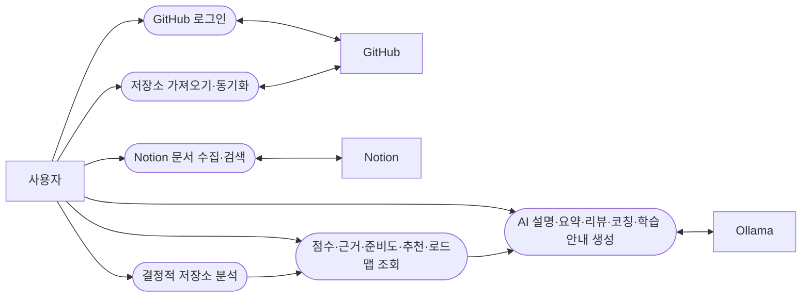

# DevPath 요구사항 명세 (SRS)

이 문서는 DevPath의 제품 개요, 범위, 요구사항 ID와 각 요구사항의 현재 상태를 정리한다. 점수 공식·가중치·밴드·정책
버전의 상세는 [docs/SCORING_RULES.md](SCORING_RULES.md), 기술 구성과 모듈 구조는
[docs/ARCHITECTURE.md](ARCHITECTURE.md), 보안 규칙은 [docs/SECURITY.md](SECURITY.md), 기술 결정은
[docs/ADR.md](ADR.md), 진행 현황은 [docs/STATUS.md](STATUS.md)에 있다. API 계약은
`contracts/openapi/devpath-openapi.yaml`이 기준이다.

상태 표기:

| 상태 | 의미 |
|---|---|
| 구현 | 코드, 마이그레이션 또는 API 계약, 자동 테스트가 있다. |
| 부분 | 요구사항의 일부만 구현되어 있다. 구현된 범위를 비고에 적는다. |
| 계획 | 아직 구현되지 않았다. 범위에는 포함된다. |
| 범위 외 | 현재 범위에서 제외했다. 2절 참고. |

요구사항 ID(FR, RR, CR, AI, PR, KR, NFR)는 다른 문서에서 참조하므로 번호를 바꾸거나 재사용하지 않는다.

## 1. 제품 개요

### 1.1 해결하려는 문제

기존 GitHub 분석 서비스는 통계를 시각화하는 데 그친다. 개발자는 자신의 저장소와 문서가 목표 직무 기준으로 어느
수준인지, 무엇이 부족한지, 다음에 무엇을 해야 하는지를 근거와 함께 알기 어렵다.

DevPath는 GitHub 저장소와 Notion 문서를 수집해 결정적 Rule Engine으로 기술 역량을 평가하고 목표 직무 기준의 준비도와
부족한 영역, 학습 로드맵을 제공한다. AI는 이 결과를 설명하는 데만 쓴다.

### 1.2 성공 지표(KPI)

| 지표 | 측정 방법 | 검증 근거 |
|---|---|---|
| 같은 스냅샷·추출기·규칙 버전 입력은 같은 공식 점수와 신뢰도를 낸다. | 동일 입력을 두 번 평가해 결과 객체와 승인된 fixture 값을 비교한다. | `DeterministicRuleEngineTest.baselineV1MatchesGoldenScoresAndIsDeterministic`, `baselineV2MatchesApprovedGoldenScoresAndIsDeterministic` |
| AI 설명의 서술 텍스트에 숫자가 들어가면 공통 출력 정책이 산출물을 거부한다. 작업별 연결은 숫자 위반을 직접 검증하는 두 산출물에서 확인한다. | 공통 정책과 Skill 설명·저장소 요약 validator가 숫자 포함 텍스트에 `UNTRACEABLE_NUMERIC_CLAIM`을 만드는지 검사한다. | `GeneratedOutputPolicyTest.validatesTextWithTheExistingSchemaNumericAndRenderSafetyOrder`, `SkillExplanationValidatorTest`, `RepositorySummaryValidatorTest` |
| 분석 작업은 일시 실패를 제한된 백오프로 재시도하고 만료 lease가 시도 한도에 닿으면 실패로 끝난다. | 재시도 지연 범위와 `WORKER_LEASE_RECOVERED`/`WORKER_LEASE_EXPIRED` 전이를 검사한다. | `AnalysisJobTest` |
| 보안 경계를 벗어난 의존과 민감정보 패턴을 저장소 검사에서 허용하지 않는다. | 보안 경계 테스트와 스캔을 실행한다. | `npm run security:check` |
| 공개 API 계약은 lint 오류 없이 유지한다. | OpenAPI 원본에 계약 lint를 실행한다. | `npm run contract:lint` |

### 1.3 대상 사용자

| 사용자 | 특성 | 주요 목적 |
|---|---|---|
| 컴퓨터공학 전공 학생 | 실무 경력이 적고 학습 프로젝트가 많다 | 기술 공백과 포트폴리오 준비도 파악 |
| 주니어 개발자 | 일부 실무·팀 경험이 있다 | 엔지니어링 성숙도 향상 |
| 직무 전환자 | 다른 분야 경력이 섞여 있다 | 기존 근거를 목표 개발 직무에 연결 |
| 포트폴리오 준비자 | 외부 공개용 결과물에 집중한다 | 근거 기반 프로젝트 정리 |
| 면접 준비자 | 특정 회사·직무를 준비한다 | 목표 기준의 부족 영역과 로드맵 |

관리자(Administrator) 사용자 유형은 현재 범위 외다.

### 1.4 제약 사항

- 로컬 실행에는 PostgreSQL/pgvector, Java 21, Node.js가 필요하고 전체 통합 검증에는 Docker도 필요하다.
- 생성과 임베딩 provider 구현은 로컬 Ollama 하나뿐이다. 실제 Notion·Ollama 대상 충분한 검증은 남아 있다.
- 외부 유료 AI 서비스는 사용하지 않는다.
- 운영 배포 플랫폼, 관측성 기술, 운영 비밀 관리 방식은 각각 Proposed ADR-033, 031, 034로 미결이다.

### 1.5 핵심 원칙

1. Rule Engine이 계산한다.
2. AI는 설명한다.
3. 직무(Career) 선택은 평가 규칙을 바꾼다.
4. 회사(Company) 선택은 회사별 평가·추천 정책을 바꾼다. (회사별 정책은 현재 범위 외)
5. 모든 결과는 측정 가능해야 한다.

### 1.6 제품 불변 규칙

다음 규칙은 어떤 기능 변경에서도 바꾸지 않는다. 위반하는 변경 요청은 중단하고 보고한다.

| 번호 | 규칙 |
|---|---|
| INV-1 | 공식 점수는 Rule Engine만 계산한다. |
| INV-2 | AI는 점수, 가중치, 준비도, 추천 우선순위, 그 밖의 결정적 결과를 계산·수정·추정·순위화하지 않는다. |
| INV-3 | 직무 선택은 적용할 평가 규칙을 바꾸고 회사 선택은 회사별 평가·추천 정책을 바꾼다. |
| INV-4 | 모든 공식 결과는 측정 가능하고 재현 가능하며 필요한 곳에 버전이 있고 근거까지 추적된다. |
| INV-5 | AI 출력은 형식·근거·증거·안전 검증을 통과하기 전까지 신뢰하지 않는다. |
| INV-6 | PostgreSQL이 구조화 데이터의 기준 저장소다. 캐시, 벡터, 프로젝션, LLM 컨텍스트는 기준이 아니다. |
| INV-7 | 사용자 소유 데이터는 사용자별로 격리하고 조회·프롬프트 조립·생성·내보내기·공개 전에 권한을 확인한다. |

### 1.7 처리 흐름

```text
GitHub / Notion 수집 → 정규화·불변 스냅샷 → Rule Engine 평가 → Skill Matrix
  → Career Readiness·Skill Gap → 결정적 추천·학습 로드맵 → (선택) AI 설명 생성·검증
```

분석 작업이 완료되면 같은 작업 안에서 Skill Matrix, 선택한 직무의 준비도, 추천과 로드맵이 순서대로 생성된다. AI 설명은
사용자가 요청할 때 별도 작업으로 생성된다.

### 1.8 기술 구성

기술 스택과 모듈 구조는 [docs/ARCHITECTURE.md](ARCHITECTURE.md)를 따른다. 이전 SRS에 적혀 있던 Redis, FastAPI,
LangChain, OpenAI, Nginx, Oracle Cloud는 사용하지 않거나 채택된 결정이 아니다. 현재 백엔드는 Spring Boot 모듈러
모놀리스이며 AI 생성과 임베딩은 Ollama 어댑터 하나로 동작한다. 배포 플랫폼은 미결(Proposed ADR-033)이다.

### 1.9 구현된 사용 사례



## 2. 범위

| 영역 | 구현 범위 | 범위 외·미구현 |
|---|---|---|
| 사용자 | GitHub OAuth 로그인, 서버 세션, CSRF, 로그아웃, 프로필, 직무·회사 선택, 연결 계정, 온보딩 진행 | 알림·개인정보 설정, 계정 비활성화(계획), 역할 부여(범위 외) |
| GitHub | 연결·해제, 저장소 목록·가져오기, 보관·복원, 수동 동기화, 불변 스냅샷(언어, 의존성, 파일 트리, 문서, 커밋, 브랜치, PR, 이슈) | 증분 동기화, 정기 동기화, 오래된 저장소 감지 |
| Notion | 연결·해제, 공유 페이지 조회, 지식 문서 수집·청킹·임베딩·보관·재색인 | 회고·학습 노트 등 페이지 분류와 분석, Rule Engine 반영 |
| Rule Engine | 8개 범주 점수, 종합 점수, 신뢰도, 근거 연결, Skill Matrix, 범주별 근거 상태, 분석 이력·비교 | 협업 점수, 성장 점수, 다중 저장소 집계, 규칙 관리 화면 |
| 직무 | Backend, Frontend 직무의 `readiness-v1` 준비도와 Skill Gap | 나머지 7개 직무, 직무 비교 |
| 회사 | 회사 카탈로그 조회와 목표 회사 선택 | 회사별 가중치·준비도·추천·면접 초점 (범위 외) |
| 추천·로드맵 | `recommendation-v1`, `roadmap-v1` 결정적 추천과 학습 로드맵, 로드맵 보관 | 외부 강의·도서·자격증 추천 |
| AI | 기술 역량 설명, 저장소 요약, 저장소 리뷰, 커리어 코칭, 학습 안내 (Ollama, 검증 후 저장) | 생성 결과 목록·수동 재시도·편집·내보내기(계획), Portfolio·Resume·Interview 생성(범위 외) |
| 대시보드 | 요약 대시보드, 상세 화면, 이력·비교, 로딩·빈·오류 상태 | 성장·활동 그래프, 기간 필터, 내보내기 |
| 검색 | Notion 지식 시맨틱 검색(지식 화면) | 통합 검색과 영역별 검색 (범위 외) |
| 관리 | 없음 | 규칙·직무·회사·프롬프트 관리, 로그·통계 화면 (범위 외) |
| 운영 | 내부 헬스 엔드포인트, 영속 감사 기록 | 운영 관측, 배포, 비밀 관리 (Proposed ADR-031, 033, 034로 보류) |

## 3. 기능 요구사항

한 줄 요구사항은 이전 SRS의 제목과 설명을 줄여 썼다. 이전 SRS의 11개 필드 형식(행위자, 선행 조건, 흐름, 수용 기준
등)은 모든 항목에서 같은 문장이 반복되어 정보가 없었으므로 삭제했다.

### 3.1 사용자 관리 (FR-001 ~ FR-020)

| ID | 요구사항 | 상태 |
|---|---|---|
| FR-001 | GitHub OAuth로 로그인한다. | 구현 |
| FR-002 | OAuth 콜백에서 state를 검증하고 로그인을 완료한다. | 구현 |
| FR-003 | 첫 로그인 시 공급자와 독립적인 `User`를 만든다. | 구현 |
| FR-004 | 불투명 서버 세션(HttpOnly 쿠키)과 절대 만료를 관리한다. | 구현 |
| FR-005 | 로그아웃하면 세션을 무효화한다. | 구현 |
| FR-006 | 사용자 프로필을 조회한다. | 구현 |
| FR-007 | 사용자 프로필을 수정한다. | 구현 |
| FR-008 | 목표 직무를 선택한다. | 구현 |
| FR-009 | 목표 회사를 선택한다. (선택만 저장, 평가에는 미반영) | 구현 |
| FR-010 | 설정 화면을 제공한다. | 구현 |
| FR-011 | 알림 설정을 변경한다. | 계획 |
| FR-012 | 데이터 개인정보 설정을 변경한다. | 계획 |
| FR-013 | 연결된 계정(GitHub, Notion)을 조회한다. | 구현 |
| FR-014 | 계정을 다시 연결한다. (해제 후 재인가로 가능, 별도 재연결 흐름 없음) | 부분 |
| FR-015 | 계정을 비활성화한다. (상태 값만 정의, API 없음) | 계획 |
| FR-016 | 역할을 부여한다. | 범위 외 |
| FR-017 | 모든 사용자 데이터 조회에 소유자 권한을 강제한다. | 구현 |
| FR-018 | 프로필 완성도를 확인한다. (온보딩 진행 단계로 대체) | 부분 |
| FR-019 | 온보딩 진행 상태를 추적한다. | 구현 |
| FR-020 | 사용자 감사 기록을 남긴다. (로그인·로그아웃·세션 만료·계정 연결만, 프로필 변경 미기록) | 부분 |

### 3.2 GitHub 연동 (FR-021 ~ FR-050)

| ID | 요구사항 | 상태 |
|---|---|---|
| FR-021 | 저장소 접근을 위한 GitHub 인가를 받는다. | 구현 |
| FR-022 | GitHub 토큰을 암호화(AES-GCM)해 서버에만 저장한다. | 구현 |
| FR-023 | 만료가 가까운 GitHub 토큰을 갱신한다. | 구현 |
| FR-024 | 접근 가능한 저장소 목록을 조회한다. | 구현 |
| FR-025 | 선택한 저장소의 메타데이터를 가져와 등록한다. | 구현 |
| FR-026 | 저장소를 동기화해 불변 스냅샷을 만든다. | 구현 |
| FR-027 | 커밋 이력을 수집한다. | 구현 |
| FR-028 | 커밋 빈도를 분석한다. (커밋 수만 활동 점수에 반영) | 부분 |
| FR-029 | 브랜치 목록을 수집한다. | 구현 |
| FR-030 | 기본 브랜치를 식별한다. | 구현 |
| FR-031 | Pull Request를 수집한다. | 구현 |
| FR-032 | PR 리뷰 신호를 추출한다. | 구현 |
| FR-033 | 이슈를 수집한다. | 구현 |
| FR-034 | 이슈 협업 신호(닫힌 이슈, 라벨)를 추출한다. | 구현 |
| FR-035 | README를 가져온다. | 구현 |
| FR-036 | README 품질 신호(구성 섹션)를 추출한다. | 구현 |
| FR-037 | 의존성 매니페스트를 감지한다. | 구현 |
| FR-038 | 의존성 메타데이터를 추출한다. | 구현 |
| FR-039 | 디렉터리 트리를 수집한다. | 구현 |
| FR-040 | 디렉터리 구조에서 아키텍처 신호를 추출한다. | 구현 |
| FR-041 | 언어 통계를 수집한다. | 구현 |
| FR-042 | 프레임워크 신호를 추출한다. | 구현 |
| FR-043 | 저장소 활동 타임라인을 만든다. | 구현 |
| FR-044 | 오래된(비활성) 저장소를 감지한다. | 계획 |
| FR-045 | 대형 저장소는 수집 한도로 제한하고 한도 초과를 알린다. | 구현 |
| FR-046 | GitHub 호출 한도 초과를 처리하고 기록한다. | 구현 |
| FR-047 | 변경분만 동기화한다. (현재는 매번 전체 스냅샷) | 계획 |
| FR-048 | 사용자가 수동으로 다시 동기화한다. | 구현 |
| FR-049 | 동기화 실패를 안전한 오류 코드로 보고한다. | 구현 |
| FR-050 | GitHub 연동 작업을 감사 기록으로 남긴다. | 구현 |

### 3.3 Notion 연동 (FR-051 ~ FR-070)

| ID | 요구사항 | 상태 |
|---|---|---|
| FR-051 | Notion OAuth 인가를 받는다. | 구현 |
| FR-052 | Notion 토큰을 암호화해 서버에만 저장한다. | 구현 |
| FR-053 | Notion 워크스페이스를 연결한다. | 구현 |
| FR-054 | 워크스페이스 메타데이터를 가져온다. | 구현 |
| FR-055 | 공유된 페이지 목록을 조회한다. | 구현 |
| FR-056 | 데이터베이스 목록을 조회한다. (Notion 검색 결과의 `DATA_SOURCE` 객체) | 구현 |
| FR-057 | 회고 페이지를 감지한다. | 계획 |
| FR-058 | 회고 내용을 분석한다. | 계획 |
| FR-059 | 문서 페이지를 감지한다. | 계획 |
| FR-060 | 문서 품질 신호를 추출한다. | 계획 |
| FR-061 | 학습 노트를 감지한다. | 계획 |
| FR-062 | 학습 노트 주제를 추출한다. | 계획 |
| FR-063 | 프로젝트 노트를 감지한다. | 계획 |
| FR-064 | 프로젝트 노트를 저장소와 연결한다. | 계획 |
| FR-065 | Notion 변경분을 동기화한다. (문서 단위 수동 재색인만) | 부분 |
| FR-066 | Notion 권한 범위를 검증한다. (활성 연결과 소유 페이지 접근만 검증) | 부분 |
| FR-067 | Notion 호출 한도 초과를 처리한다. | 구현 |
| FR-068 | Notion 수집 실패를 보고한다. | 구현 |
| FR-069 | Notion 연결을 해제한다. | 구현 |
| FR-070 | Notion 연동 작업을 감사 기록으로 남긴다. | 구현 |

### 3.4 데이터 수집 (FR-071 ~ FR-100)

| ID | 요구사항 | 상태 |
|---|---|---|
| FR-071 | 수집 작업을 만든다. | 구현 |
| FR-072 | 수집 작업을 PostgreSQL 영속 큐에 넣는다. | 구현 |
| FR-073 | 수집 작업을 정기 실행한다. | 계획 |
| FR-074 | GitHub 수집기를 실행한다. | 구현 |
| FR-075 | Notion 수집기를 실행한다. | 구현 |
| FR-076 | 실패한 수집을 제한된 횟수로 재시도한다. | 구현 |
| FR-077 | 원본 데이터를 저장한다. (공급자 원본이 아닌 정규화된 사실을 저장) | 부분 |
| FR-078 | 원본 데이터 버전을 관리한다. (불변 스냅샷 단위) | 부분 |
| FR-079 | 수집 데이터를 정규화한다. | 구현 |
| FR-080 | 저장소 엔티티를 정규화한다. | 구현 |
| FR-081 | 커밋 엔티티를 정규화한다. | 구현 |
| FR-082 | PR 엔티티를 정규화한다. | 구현 |
| FR-083 | 이슈 엔티티를 정규화한다. | 구현 |
| FR-084 | Notion 페이지를 지식 문서로 정규화한다. | 구현 |
| FR-085 | 기술 엔티티를 정규화한다. | 구현 |
| FR-086 | 근거 엔티티를 정규화한다. | 구현 |
| FR-087 | 중복을 감지한다. (지식 문서 내용 해시, 저장소 등록 중복) | 부분 |
| FR-088 | 캐시를 읽는다. | 범위 외 |
| FR-089 | 캐시에 쓴다. | 범위 외 |
| FR-090 | 캐시를 무효화한다. (서버 캐시 없음, 프런트엔드 React Query 무효화만 존재) | 범위 외 |
| FR-091 | 동기화 상태를 추적한다. | 구현 |
| FR-092 | 증분 커서를 관리한다. | 계획 |
| FR-093 | 수집 진행률을 보고한다. | 구현 |
| FR-094 | 수집 작업을 취소한다. | 계획 |
| FR-095 | 수집 오류를 분류한다. | 구현 |
| FR-096 | 외부 API 시간 초과를 처리한다. | 구현 |
| FR-097 | 데이터 보존 기간을 강제한다. | 계획 |
| FR-098 | 민감 데이터를 거른다. (프롬프트 조립 전 비밀 패턴 차단만) | 부분 |
| FR-099 | 수집 지표를 기록한다. | 계획 |
| FR-100 | 수집 작업을 감사 기록으로 남긴다. | 구현 |

### 3.5 Rule Engine (FR-101 ~ FR-180)

현재 활성 규칙 세트는 `baseline-v2`이며 범주는 LANGUAGE, FRAMEWORK, DATABASE, ARCHITECTURE, TESTING, DEVOPS,
DOCUMENTATION, ACTIVITY 8개다. 협업(COLLABORATION) 신호는 근거로 추출되지만 점수 범주에는 없다. 세부 규칙과 가중치는
[docs/SCORING_RULES.md](SCORING_RULES.md)에 있다.

| ID | 요구사항 | 상태 |
|---|---|---|
| FR-101 | 언어를 분석한다. | 구현 |
| FR-102 | 주 언어를 판정한다. | 구현 |
| FR-103 | 언어 다양성을 측정한다. | 구현 |
| FR-104 | 프레임워크를 분석한다. | 구현 |
| FR-105 | 프런트엔드 프레임워크를 감지한다. | 구현 |
| FR-106 | 백엔드 프레임워크를 감지한다. (감지 사전에 포함된 프레임워크만) | 부분 |
| FR-107 | AI 프레임워크를 감지한다. | 계획 |
| FR-108 | 모바일 프레임워크를 감지한다. | 계획 |
| FR-109 | 게임 프레임워크를 감지한다. | 계획 |
| FR-110 | 임베디드 프레임워크를 감지한다. | 계획 |
| FR-111 | 데이터베이스 사용을 분석한다. | 구현 |
| FR-112 | 관계형 데이터베이스를 감지한다. | 구현 |
| FR-113 | NoSQL 데이터베이스를 감지한다. | 구현 |
| FR-114 | 벡터 데이터베이스를 감지한다. | 계획 |
| FR-115 | 아키텍처를 분석한다. | 구현 |
| FR-116 | 계층형 구조를 감지한다. | 구현 |
| FR-117 | 모듈 구조를 감지한다. | 구현 |
| FR-118 | 클린 아키텍처 신호를 감지한다. (헥사고날 경계 근거만) | 부분 |
| FR-119 | 마이크로서비스 신호를 감지한다. | 계획 |
| FR-120 | 모놀리스 신호를 감지한다. | 계획 |
| FR-121 | 테스트를 분석한다. | 구현 |
| FR-122 | 단위 테스트를 감지한다. (테스트 파일과 프레임워크만, 유형 구분 없음) | 부분 |
| FR-123 | 통합 테스트를 감지한다. | 계획 |
| FR-124 | E2E 테스트를 감지한다. | 계획 |
| FR-125 | 테스트 커버리지 신호를 추출한다. | 계획 |
| FR-126 | 테스트 품질을 점수화한다. (TESTING 범주 점수) | 부분 |
| FR-127 | DevOps를 분석한다. | 구현 |
| FR-128 | Docker 사용을 감지한다. | 구현 |
| FR-129 | CI 워크플로를 감지한다. | 구현 |
| FR-130 | 배포 설정을 감지한다. | 구현 |
| FR-131 | 인프라 코드 신호를 감지한다. | 구현 |
| FR-132 | 문서화를 분석한다. | 구현 |
| FR-133 | README 완성도를 점수화한다. (README 존재만 점수, 섹션 신호는 근거) | 부분 |
| FR-134 | API 문서를 감지한다. | 구현 |
| FR-135 | 아키텍처 문서를 감지한다. | 구현 |
| FR-136 | 학습 문서 신호를 감지한다. | 계획 |
| FR-137 | 협업을 분석한다. (근거 추출만, 점수 없음) | 부분 |
| FR-138 | PR 협업을 점수화한다. | 계획 |
| FR-139 | 이슈 관리를 점수화한다. | 계획 |
| FR-140 | 리뷰 활동을 점수화한다. | 계획 |
| FR-141 | 커밋 메시지 품질을 점수화한다. | 계획 |
| FR-142 | Skill Matrix를 생성한다. | 구현 |
| FR-143 | 기술 역량마다 근거를 연결한다. | 구현 |
| FR-144 | 활동 점수를 계산한다. (ACTIVITY 범주) | 구현 |
| FR-145 | 성장 점수를 계산한다. | 계획 |
| FR-146 | 아키텍처 점수를 계산한다. | 구현 |
| FR-147 | 문서화 점수를 계산한다. | 구현 |
| FR-148 | 종합 점수를 계산한다. | 구현 |
| FR-149 | 활성 규칙 버전을 선택한다. | 구현 |
| FR-150 | 규칙·범주 가중치를 적용한다. | 구현 |
| FR-151 | 직무 가중치를 적용한다. (준비도 계산에서 적용) | 구현 |
| FR-152 | 회사 가중치를 적용한다. | 범위 외 |
| FR-153 | 점수 설명용 근거를 묶어 제공한다. (점수 분해, 근거 API) | 구현 |
| FR-154 | 점수 범위(0~100)를 검증한다. | 구현 |
| FR-155 | 누락 데이터를 규칙별 정책(`ZERO`, `SKIP`)으로 처리한다. | 구현 |
| FR-156 | 규칙별 실행 결과를 남긴다. | 구현 |
| FR-157 | 규칙 회귀 테스트를 지원한다. (결정적 fixture) | 구현 |
| FR-158 | 규칙 설정을 검증한다. (DB 제약과 도메인 검증) | 부분 |
| FR-159 | 규칙 충돌을 감지한다. | 계획 |
| FR-160 | 규칙 결과를 저장한다. | 구현 |
| FR-161 | 규칙 결과에 버전을 남긴다. | 구현 |
| FR-162 | 재계산을 시작한다. (사용자의 분석 요청으로만) | 부분 |
| FR-163 | Rule Engine 성능을 측정한다. | 계획 |
| FR-164 | Rule Engine 오류를 안전하게 보고한다. | 구현 |
| FR-165 | Rule Engine 작업을 감사 기록으로 남긴다. (분석 결과 조회·이력·비교만 기록, 분석 실행은 미기록) | 부분 |
| FR-166 | 관리자 규칙 미리보기를 제공한다. | 범위 외 |
| FR-167 | 규칙 임계값을 관리한다. | 범위 외 |
| FR-168 | 최소 근거 수를 강제한다. (`skill-matrix-v3` 근거 상태) | 구현 |
| FR-169 | 규칙 결과를 내보낸다. | 계획 |
| FR-170 | 결정성을 검증한다. (같은 입력·버전 → 같은 결과 테스트) | 구현 |
| FR-171 | 규칙 의존 관계를 매핑한다. | 계획 |
| FR-172 | 규칙 폐기를 처리한다. (새 정책 버전이 이전 버전을 대체) | 부분 |
| FR-173 | 규칙 변경 영향을 시뮬레이션한다. | 계획 |
| FR-174 | 기술 분류 체계를 관리한다. | 범위 외 |
| FR-175 | 점수를 0~100으로 정규화한다. | 구현 |
| FR-176 | 근거 최신성에 가중치를 둔다. | 계획 |
| FR-177 | 여러 저장소를 집계한다. (현재 Skill Matrix는 분석한 저장소 하나 기준) | 계획 |
| FR-178 | 규칙 세트를 롤백한다. | 계획 |
| FR-179 | 규칙 벤치마크를 보고한다. | 계획 |
| FR-180 | 규칙 커버리지를 보고한다. | 계획 |

### 3.6 Career Path Engine (FR-181 ~ FR-220)

| ID | 요구사항 | 상태 |
|---|---|---|
| FR-181 | 목표 직무를 선택한다. | 구현 |
| FR-182 | 직무 선택과 버전 있는 직무 프로필을 저장한다. | 구현 |
| FR-183 | 직무별 평가 기준을 선택한다. | 구현 |
| FR-184 | 직무별 프롬프트를 선택한다. (커리어 코칭 프롬프트에 직무 사실 주입) | 부분 |
| FR-185 | 직무별 추천 기준을 선택한다. | 구현 |
| FR-186 | Backend 직무를 평가한다. | 구현 |
| FR-187 | Frontend 직무를 평가한다. | 구현 |
| FR-188 | AI Engineer 직무를 평가한다. | 계획 |
| FR-189 | DevOps 직무를 평가한다. | 계획 |
| FR-190 | Security 직무를 평가한다. | 계획 |
| FR-191 | Game 직무를 평가한다. | 계획 |
| FR-192 | Embedded 직무를 평가한다. | 계획 |
| FR-193 | Mobile 직무를 평가한다. | 계획 |
| FR-194 | Data Engineer 직무를 평가한다. | 계획 |
| FR-195 | Skill Gap을 분석한다. | 구현 |
| FR-196 | 직무 준비도를 계산한다. | 구현 |
| FR-197 | 학습 로드맵을 생성한다. | 구현 |
| FR-198 | 학습 우선순위를 정한다. | 구현 |
| FR-199 | 마일스톤을 정의한다. | 구현 |
| FR-200 | 로드맵 진행을 추적한다. (단계 상태 표시, 자동 완료 판정은 후속 분석 기준) | 부분 |
| FR-201 | 직무 변경 시 다시 계산한다. (다음 분석 완료 시 새 직무로 계산) | 부분 |
| FR-202 | 직무 간 비교를 제공한다. | 계획 |
| FR-203 | 직무 기준 근거를 연결한다. | 구현 |
| FR-204 | 직무 기준 약점을 식별한다. | 구현 |
| FR-205 | 직무 기준 강점을 식별한다. | 구현 |
| FR-206 | 추천의 근거를 추적한다. | 구현 |
| FR-207 | 목표 회사를 선택한다. | 구현 |
| FR-208 | 회사 프로필 카탈로그를 저장한다. | 구현 |
| FR-209 | 회사별 규칙 세트를 선택한다. | 범위 외 |
| FR-210 | 회사 가중치를 적용한다. | 범위 외 |
| FR-211 | Google 준비도를 매핑한다. | 범위 외 |
| FR-212 | Amazon 준비도를 매핑한다. | 범위 외 |
| FR-213 | Naver 준비도를 매핑한다. | 범위 외 |
| FR-214 | Kakao 준비도를 매핑한다. | 범위 외 |
| FR-215 | Toss 준비도를 매핑한다. | 범위 외 |
| FR-216 | Coupang 준비도를 매핑한다. | 범위 외 |
| FR-217 | 회사별 면접 초점을 매핑한다. | 범위 외 |
| FR-218 | 회사별 추천을 생성한다. | 범위 외 |
| FR-219 | Career Engine 작업을 감사 기록으로 남긴다. (학습 로드맵 작업만) | 부분 |
| FR-220 | 근거 부족 등 Career Engine 오류 상태를 보고한다. | 구현 |

### 3.7 AI Engine (FR-221 ~ FR-280)

구현된 AI 작업은 기술 역량 설명, 저장소 요약, 저장소 리뷰, 커리어 코칭, 학습 안내 5가지다. 모두 Ollama 생성 어댑터를
쓰며 검증을 통과한 결과만 저장한다.

| ID | 요구사항 | 상태 |
|---|---|---|
| FR-221 | 작업별 Prompt Builder로 프롬프트를 만든다. | 구현 |
| FR-222 | 시스템 프롬프트를 구성한다. | 구현 |
| FR-223 | 직무 프롬프트를 구성한다. (커리어 코칭·학습 안내의 직무 사실) | 부분 |
| FR-224 | 회사 프롬프트를 구성한다. | 범위 외 |
| FR-225 | Rule Engine 결과 프롬프트를 구성한다. | 구현 |
| FR-226 | 출력 형식 프롬프트를 구성한다. | 구현 |
| FR-227 | 프롬프트 안전 장치(비밀 차단, 토큰 예산)를 적용한다. | 구현 |
| FR-228 | 작업별 컨텍스트를 조립한다. | 구현 |
| FR-229 | Rule Engine 결과를 불변 사실로 주입한다. | 구현 |
| FR-230 | 저장소 요약을 생성한다. | 구현 |
| FR-231 | 기술 역량 분석을 설명한다. | 구현 |
| FR-232 | 저장소 리뷰를 생성한다. | 구현 |
| FR-233 | 커리어 코칭 응답을 생성한다. | 구현 |
| FR-234 | 포트폴리오를 생성한다. | 범위 외 |
| FR-235 | 이력서를 생성한다. | 범위 외 |
| FR-236 | README 개선안을 생성한다. | 계획 |
| FR-237 | 면접 질문을 생성한다. | 범위 외 |
| FR-238 | 학습 계획을 설명한다. (학습 안내) | 구현 |
| FR-239 | 약점 영역을 설명한다. (커리어 코칭 안에서) | 부분 |
| FR-240 | 성장 추세를 설명한다. | 계획 |
| FR-241 | 회사 준비도를 설명한다. | 범위 외 |
| FR-242 | 로드맵을 설명한다. | 구현 |
| FR-243 | AI 추천 카드를 생성한다. | 계획 |
| FR-244 | 응답이 제공된 근거에 기반하는지 검증한다. | 구현 |
| FR-245 | 근거 없는 내용을 차단한다. | 구현 |
| FR-246 | AI 출력의 점수 계산을 금지한다. (추적되지 않는 숫자 거부) | 구현 |
| FR-247 | 근거 인용을 포함한다. | 구현 |
| FR-248 | 출력 스키마를 검증한다. | 구현 |
| FR-249 | AI 공급자를 선택한다. (공급자 포트, 어댑터는 Ollama 하나) | 부분 |
| FR-250 | Ollama를 호출한다. | 구현 |
| FR-251 | OpenAI API를 호출한다. | 계획 |
| FR-252 | AI 시간 초과를 처리한다. | 구현 |
| FR-253 | AI 호출을 제한된 횟수로 재시도한다. | 구현 |
| FR-254 | AI 오류를 안전한 코드로 보고한다. | 구현 |
| FR-255 | AI 사용량을 기록한다. | 계획 |
| FR-256 | AI 비용을 기록한다. | 계획 |
| FR-257 | 프롬프트 버전을 기록한다. | 구현 |
| FR-258 | 응답에 버전을 남긴다. | 구현 |
| FR-259 | 콘텐츠를 검토(모더레이션)한다. | 계획 |
| FR-260 | 프롬프트 조립 전 개인정보·비밀을 거른다. | 구현 |
| FR-261 | AI 캐시를 조회한다. | 계획 |
| FR-262 | AI 캐시에 쓴다. | 계획 |
| FR-263 | 대화 컨텍스트를 유지한다. | 계획 |
| FR-264 | AI 결과 피드백을 받는다. | 계획 |
| FR-265 | 추천 설명을 다시 생성한다. (새 생성 요청만, 수동 재시도 API 없음) | 부분 |
| FR-266 | 보고서를 텍스트로 내보낸다. | 계획 |
| FR-267 | 보고서를 Markdown으로 내보낸다. | 계획 |
| FR-268 | 한국어로 출력한다. | 구현 |
| FR-269 | 영어로 출력한다. | 계획 |
| FR-270 | 어조를 조절한다. | 계획 |
| FR-271 | 길이를 조절한다. | 계획 |
| FR-272 | 면접 난이도를 조절한다. | 범위 외 |
| FR-273 | 이력서 목표 직무를 지정한다. | 범위 외 |
| FR-274 | 포트폴리오 프로젝트를 선택한다. | 범위 외 |
| FR-275 | README 섹션을 생성한다. | 계획 |
| FR-276 | 학습 자료를 구조화한다. | 계획 |
| FR-277 | AI 작업을 감사 기록으로 남긴다. | 구현 |
| FR-278 | 제공된 사실 외의 출처 사용을 제한한다. | 구현 |
| FR-279 | 프롬프트 인젝션에 대응한다. (시스템 지시 노출 거부, 렌더링 안전 검사) | 부분 |
| FR-280 | 생성 결과를 저장한다. | 구현 |

### 3.8 대시보드·화면 (FR-281 ~ FR-320)

| ID | 요구사항 | 상태 |
|---|---|---|
| FR-281 | 대시보드 홈을 제공한다. | 구현 |
| FR-282 | Skill Matrix 화면을 제공한다. | 구현 |
| FR-283 | 기술 역량 상세로 이동한다. | 구현 |
| FR-284 | 성장 그래프를 보여준다. | 계획 |
| FR-285 | 활동 그래프를 보여준다. | 계획 |
| FR-286 | 기술 분포를 보여준다. (저장소별 기술 목록만) | 부분 |
| FR-287 | 추천 카드를 보여준다. (결정적 추천 카드) | 구현 |
| FR-288 | 직무 준비도 진행을 보여준다. | 구현 |
| FR-289 | 회사 준비도를 보여준다. | 범위 외 |
| FR-290 | 저장소 상세를 보여준다. | 구현 |
| FR-291 | 저장소 점수 분해를 보여준다. | 구현 |
| FR-292 | 문서화 점수를 보여준다. | 구현 |
| FR-293 | 아키텍처 점수를 보여준다. | 구현 |
| FR-294 | 테스트 점수를 보여준다. | 구현 |
| FR-295 | DevOps 점수를 보여준다. | 구현 |
| FR-296 | 협업 점수를 보여준다. (점수 없음) | 계획 |
| FR-297 | 약점 영역을 보여준다. (Skill Gap) | 구현 |
| FR-298 | 강점 영역을 보여준다. | 구현 |
| FR-299 | 학습 로드맵을 보여준다. | 구현 |
| FR-300 | 포트폴리오 미리보기를 보여준다. | 범위 외 |
| FR-301 | 이력서 미리보기를 보여준다. | 범위 외 |
| FR-302 | README 개선안을 보여준다. | 계획 |
| FR-303 | 면접 질문을 보여준다. | 범위 외 |
| FR-304 | 동기화 상태를 보여준다. | 구현 |
| FR-305 | 분석 이력을 보여준다. | 구현 |
| FR-306 | 분석·Skill Matrix 비교를 보여준다. | 구현 |
| FR-307 | 저장소로 거른다. (저장소별 분석 이력) | 부분 |
| FR-308 | 기간으로 거른다. | 계획 |
| FR-309 | 직무로 거른다. | 계획 |
| FR-310 | 회사로 거른다. | 범위 외 |
| FR-311 | 로딩 상태를 보여준다. | 구현 |
| FR-312 | 빈 상태를 보여준다. | 구현 |
| FR-313 | 오류 상태를 보여준다. (401, 404/403, 네트워크, 내부 오류 구분) | 구현 |
| FR-314 | 대시보드를 내보낸다. | 계획 |
| FR-315 | 반응형 레이아웃을 제공한다. | 구현 |
| FR-316 | 점수 표시에 접근 가능한 텍스트를 제공한다. (차트는 없음) | 구현 |
| FR-317 | 데이터 변경 후 화면을 새로 고친다. | 구현 |
| FR-318 | 대시보드 서버 캐시를 쓴다. | 범위 외 |
| FR-319 | 대시보드 조회에 소유자 권한을 강제한다. | 구현 |
| FR-320 | 대시보드 조회를 감사 기록으로 남긴다. | 구현 |

### 3.9 검색 (FR-321 ~ FR-340)

통합 검색은 범위 외다. Notion 지식 문서의 시맨틱 검색만 지식 화면에서 제공한다.

| ID | 요구사항 | 상태 |
|---|---|---|
| FR-321 | 통합 검색 | 범위 외 |
| FR-322 | 저장소 검색 | 범위 외 |
| FR-323 | 추천 검색 | 범위 외 |
| FR-324 | 보고서 검색 | 범위 외 |
| FR-325 | 기술 역량 검색 | 범위 외 |
| FR-326 | 기술 검색 | 범위 외 |
| FR-327 | Notion 문서 검색 (소유자 필터 시맨틱 검색과 인용) | 부분 |
| FR-328 | 학습 노트 검색 | 범위 외 |
| FR-329 | 면접 질문 검색 | 범위 외 |
| FR-330 | 포트폴리오 내용 검색 | 범위 외 |
| FR-331 | 이력서 내용 검색 | 범위 외 |
| FR-332 | 날짜 필터 | 범위 외 |
| FR-333 | 직무 필터 | 범위 외 |
| FR-334 | 회사 필터 | 범위 외 |
| FR-335 | 저장소 필터 | 범위 외 |
| FR-336 | 결과 순위 | 범위 외 |
| FR-337 | 결과 강조 표시 | 범위 외 |
| FR-338 | 검색 빈 상태 | 범위 외 |
| FR-339 | 검색 권한 강제 | 범위 외 |
| FR-340 | 검색 감사 기록 | 범위 외 |

지식 검색 자체의 권한 강제와 감사 기록은 KR-017, KR-020으로 관리한다.

### 3.10 관리 (FR-341 ~ FR-360)

관리자 기능 전체가 범위 외다. 규칙·직무·회사·프롬프트 정책은 Flyway 마이그레이션으로만 바꾼다.

| ID | 요구사항 | 상태 |
|---|---|---|
| FR-341 | 관리자 로그인 권한 | 범위 외 |
| FR-342 | 규칙 관리 화면 | 범위 외 |
| FR-343 | 규칙 생성 | 범위 외 |
| FR-344 | 규칙 수정 | 범위 외 |
| FR-345 | 규칙 비활성화 | 범위 외 |
| FR-346 | 규칙 버전 게시 | 범위 외 |
| FR-347 | 직무 관리 화면 | 범위 외 |
| FR-348 | 직무 규칙 매핑 수정 | 범위 외 |
| FR-349 | 회사 규칙 관리 화면 | 범위 외 |
| FR-350 | 회사 가중치 수정 | 범위 외 |
| FR-351 | 프롬프트 관리 화면 | 범위 외 |
| FR-352 | 프롬프트 생성 | 범위 외 |
| FR-353 | 프롬프트 수정 | 범위 외 |
| FR-354 | 프롬프트 버전 게시 | 범위 외 |
| FR-355 | 로그 화면 | 범위 외 |
| FR-356 | 감사 기록 검색 | 범위 외 |
| FR-357 | 통계 화면 | 범위 외 |
| FR-358 | 시스템 상태 화면 | 범위 외 |
| FR-359 | 관리자 권한 강제 | 범위 외 |
| FR-360 | 관리자 작업 감사 기록 | 범위 외 |

### 3.11 기능 그룹 우선순위

우선순위는 현재 제품 불변 규칙과 구현 범위를 기준으로 한 개발 단계 분류다. 개별 요구사항의 상태를 바꾸지는 않는다.

| 그룹 | 우선순위 | 근거 |
|---|---|---|
| 3.1 사용자 관리 | Must | 인증·세션·소유자 격리의 시작점이다. |
| 3.2 GitHub 연동 | Must | 저장소 근거 수집의 필수 출처다. |
| 3.3 Notion 연동 | Should | 지식 수집에 필요하지만 공식 점수 입력에는 아직 쓰지 않는다. |
| 3.4 데이터 수집 | Must | 불변 스냅샷과 추적 가능한 근거를 만든다. |
| 3.5 Rule Engine | Must | 공식 점수의 유일한 계산 경로다. |
| 3.6 Career Path Engine | Must | 직무 준비도, 추천, 로드맵의 결정적 경로다. |
| 3.7 AI Engine | Should | 공식 결과를 설명하지만 결과 계산에는 필요하지 않다. |
| 3.8 대시보드·화면 | Must | 구현된 결과와 비동기 상태를 사용자가 확인하는 경로다. |
| 3.9 검색 | Could | Notion 지식 검색은 부분 구현됐으며 핵심 분석 흐름과 독립적이다. |
| 3.10 관리 | Won't | 관리자 기능은 현재 범위 외다. |
| 4.1 Rule Engine | Must | 재현 가능한 공식 평가를 정의한다. |
| 4.2 Career Path Engine | Must | 직무 기준 결과와 결정적 후속 행동을 정의한다. |
| 4.3 AI | Should | 검증된 설명 기능이며 공식 결과를 바꾸지 않는다. |
| 4.4 프롬프트 | Should | AI 경계와 출력 계약을 강제한다. |
| 4.5 지식 | Should | Notion 수집·검색을 제공하며 분석 반영은 미구현이다. |
| 4.6 회사 규칙 | Won't | 회사별 평가·추천 정책은 현재 범위 외다. |

## 4. 엔진 요구사항

엔진 요구사항은 엔진 단위의 상위 요구사항이다. 공식과 정책 수치는 [docs/SCORING_RULES.md](SCORING_RULES.md), 구성
요소와 흐름은 [docs/ARCHITECTURE.md](ARCHITECTURE.md)에서 다룬다.

### 4.1 Rule Engine (RR)

| ID | 요구사항 | 측정 기준 | 상태 |
|---|---|---|---|
| RR-001 | 공급자 통계와 파일 근거로 언어를 식별한다. | 스냅샷별 언어 비율 합이 100% ±0.5% | 구현 |
| RR-002 | 의존성·구조·설정에서 프레임워크를 감지한다. | 이름과 근거 출처 포함 (감지 사전 범위 한정) | 부분 |
| RR-003 | 관계형, NoSQL, 캐시, 벡터 DB 사용을 감지한다. | 근거 경로·의존성·설정 참조 포함 (벡터 DB 미감지) | 부분 |
| RR-004 | 디렉터리 구조와 모듈 경계로 아키텍처를 평가한다. | 같은 스냅샷·규칙 버전에서 같은 점수 | 구현 |
| RR-005 | 테스트 존재, 프레임워크, CI 실행 근거를 평가한다. | 테스트 수, 프레임워크, 근거 범주 (테스트 유형 미구분) | 부분 |
| RR-006 | Docker, CI/CD, 배포, 인프라 신호를 평가한다. | 신호 유무와 가중 점수 | 구현 |
| RR-007 | README, API·아키텍처 문서, 학습 노트를 평가한다. | 완성도 점검과 근거 (학습 노트 미반영) | 부분 |
| RR-008 | PR, 리뷰, 이슈, 커밋 메시지로 협업을 평가한다. | 수와 비율 (근거만 추출, 점수 없음) | 부분 |
| RR-009 | 결정적 근거와 정책으로 Skill Matrix를 만든다. | 항목마다 점수, 수준, 근거 ID, 정책 버전, 시각 | 구현 |
| RR-010 | 범주 가중치로 종합 점수를 계산한다. | 가중 공식과 정확히 일치 | 구현 |

### 4.2 Career Path Engine (CR)

이전 SRS는 CR-006까지만 정의하면서 본문에서 CR-009를 참조했다. Career Path Engine 명세에는 CR-001~CR-020이 있으므로
전체를 여기에 둔다.

| ID | 요구사항 | 상태 |
|---|---|---|
| CR-001 | 선택한 직무를 활성 직무 프로필로 해석한다. | 구현 |
| CR-002 | 직무별 역량 기대치와 가중치를 선택한다. (Backend, Frontend) | 구현 |
| CR-003 | 선택한 회사를 회사 프로필로 해석한다. (카탈로그 조회와 선택 저장) | 구현 |
| CR-004 | 회사별 강조점과 가중치를 적용한다. | 범위 외 |
| CR-005 | 현재 Skill Matrix를 직무·회사 기대치와 비교한다. (직무 기준만) | 부분 |
| CR-006 | 공백, 선행 순서, 우선순위로 학습 로드맵을 만든다. (`roadmap-v1`) | 구현 |
| CR-007 | 직무 준비도를 분류한다. (`readiness-v1`) | 구현 |
| CR-008 | 회사 준비도를 직무 준비도와 따로 분류한다. | 범위 외 |
| CR-009 | 구조화된 추천 객체를 만든다. (`recommendation-v1`) | 구현 |
| CR-010 | 추천 우선순위를 정한다. (회사 강조점 제외) | 구현 |
| CR-011 | 부족 역량에서 기술 우선순위를 도출한다. | 계획 |
| CR-012 | 측정 가능한 근거를 만드는 프로젝트를 추천한다. (Project 유형 추천만) | 부분 |
| CR-013 | Prompt Builder용 구조화 사실을 조립한다. | 구현 |
| CR-014 | 직무와 회사 우선순위 충돌을 감지한다. | 범위 외 |
| CR-015 | 근거 부족을 감지해 `INSUFFICIENT_EVIDENCE`로 처리한다. | 구현 |
| CR-016 | 평가 결과를 프로필 버전, 출처와 함께 저장한다. | 구현 |
| CR-017 | Rule Engine 결과나 선택이 바뀌면 다시 계산한다. (분석 완료 시에만) | 부분 |
| CR-018 | 평가 전에 직무·회사 프로필 버전을 검증한다. | 부분 |
| CR-019 | 확장 후보 직무·회사를 운영 선택에 쓰지 못하게 한다. | 구현 |
| CR-020 | 준비도, 공백, 로드맵, 추천 결정의 감사 추적을 남긴다. | 부분 |

### 4.3 AI (AI)

| ID | 요구사항 | 상태 |
|---|---|---|
| AI-001 | 버전 있는 프롬프트 구성 요소와 검증된 변수로 프롬프트를 만든다. | 구현 |
| AI-002 | 저장소 메타데이터, Rule Engine 결과, 근거로 저장소 요약을 만든다. | 구현 |
| AI-003 | Skill Matrix 항목을 점수 계산 없이 설명한다. | 구현 |
| AI-004 | 측정된 결과에 근거한 저장소 리뷰를 만든다. | 구현 |
| AI-005 | 포트폴리오 초안을 만든다. | 범위 외 |
| AI-006 | 이력서 문안을 만든다. | 범위 외 |
| AI-007 | 면접 질문 세트를 만든다. | 범위 외 |
| AI-008 | 학습 로드맵을 사용자 언어로 설명한다. | 구현 |
| AI-009 | README 개선안을 만든다. | 계획 |
| AI-010 | Career Path Engine 결과를 코칭 내용으로 설명한다. | 구현 |
| AI-011 | 직무·회사 맥락에서 기술의 의미를 설명한다. | 계획 |
| AI-012 | 토큰 한도 안에서 작업별 컨텍스트를 조립한다. | 구현 |
| AI-013 | 스키마, 근거, 안전, 점수 정책으로 응답을 검증한다. | 구현 |
| AI-014 | 작업·개인정보·비용·가용성 기준으로 모델을 고른다. (Ollama 단일) | 부분 |
| AI-015 | 검증된 결과를 출처, 프롬프트, 모델, 검증 정보와 함께 저장한다. | 구현 |

### 4.4 프롬프트 (PR)

| ID | 요구사항 | 상태 |
|---|---|---|
| PR-001 | AI 경계를 강제하는 버전 있는 시스템 프롬프트를 관리한다. | 구현 |
| PR-002 | 직무 사실로 직무 프롬프트 요소를 선택한다. | 부분 |
| PR-003 | 회사 준비도 사실로 회사 프롬프트 요소를 선택한다. | 범위 외 |
| PR-004 | Rule Engine 결과를 불변 사실로 넣는다. | 구현 |
| PR-005 | 작업별 출력 형식과 스키마 참조를 붙인다. | 구현 |
| PR-006 | 정해진 순서로 프롬프트 요소를 조립한다. | 구현 |
| PR-007 | 검증·정제한 타입 변수를 바인딩한다. | 부분 |
| PR-008 | 호출 전 완전성, 안전, 토큰 한도를 검증한다. | 구현 |
| PR-009 | 템플릿과 출력 스키마에 버전을 둔다. | 구현 |
| PR-010 | 토큰 사용량을 추정하고 한도를 강제한다. | 구현 |
| PR-011 | 인젝션 방어, 비밀 제거, 지시 계층을 강제한다. | 부분 |
| PR-012 | 프롬프트 수명주기 이벤트를 비식별 메타데이터로 남긴다. | 부분 |
| PR-013 | 초안·활성·폐기·보관 템플릿 상태를 관리한다. | 계획 |
| PR-014 | 승인된 압축·우선순위 전략으로 프롬프트를 최적화한다. | 계획 |
| PR-015 | 공급자 중립 프롬프트 패키지를 만든다. (어댑터는 Ollama 하나) | 부분 |

### 4.5 지식 (KR)

| ID | 요구사항 | 상태 |
|---|---|---|
| KR-001 | 권한 있는 지식 출처를 수집한다. (Notion만) | 부분 |
| KR-002 | 출처 레코드를 지식 문서로 만든다. | 구현 |
| KR-003 | 검색용 메타데이터를 추출한다. | 구현 |
| KR-004 | 내용을 검색 청크로 나눈다. | 구현 |
| KR-005 | 정제된 청크의 임베딩을 만든다. (Ollama) | 구현 |
| KR-006 | 임베딩을 벡터 저장소(pgvector)에 저장한다. | 구현 |
| KR-007 | 키워드·메타데이터 색인을 유지한다. | 계획 |
| KR-008 | 시맨틱 유사도로 권한 있는 청크를 찾는다. | 구현 |
| KR-009 | 시맨틱, 키워드, 최신성을 결합해 검색한다. | 계획 |
| KR-010 | 직무 맥락으로 검색한다. | 계획 |
| KR-011 | 회사 맥락으로 검색한다. | 범위 외 |
| KR-012 | 시간 조건으로 검색한다. | 계획 |
| KR-013 | 검색 결과를 컨텍스트 묶음으로 조립한다. (검색 응답 인용만, AI 컨텍스트에는 미사용) | 부분 |
| KR-014 | 출처, 동기화, 색인, 임베딩 최신성을 추적한다. | 부분 |
| KR-015 | 출처 변경 시 증분으로 갱신한다. (문서 단위 수동 재색인) | 부분 |
| KR-016 | 삭제·해제된 출처를 검색에서 제외한다. (보관 시 청크를 STALE로 표시) | 부분 |
| KR-017 | 색인과 검색에서 사용자 격리를 강제한다. | 구현 |
| KR-018 | 색인을 다시 만든다. (문서 단위) | 부분 |
| KR-019 | 여러 임베딩 공급자를 지원한다. (포트 구조, 어댑터는 Ollama 하나) | 부분 |
| KR-020 | 검색·색인·동기화·삭제 작업을 기록한다. | 구현 |

### 4.6 회사 규칙

이전 SRS 11절의 회사별 강조점(Google, Amazon, Naver, Kakao, Toss, Coupang)은 범위 외다. 6개 회사는 카탈로그와 목표
선택에만 쓰이고 점수·준비도·추천에는 반영되지 않는다.

## 5. 비기능 요구사항

구현되었거나 현실적으로 계획된 항목만 둔다. 측정 수단이 없는 응답 시간 SLA와 백업 복구 훈련은 삭제했다.

| ID | 분류 | 요구사항 | 확인 방법 | 상태 |
|---|---|---|---|---|
| NFR-001 | 보안 | OAuth 토큰은 암호화해 저장하고 로그·응답에 노출하지 않는다. | 자격 증명 암호화 테스트, 보안 경계 테스트와 저장소 스캔 | 구현 |
| NFR-002 | 보안 | 인증과 소유자 격리를 강제한다. 관리자 역할 기반 권한은 범위 외다. | 비인증 401, 타 사용자 자원 404 통합 테스트 | 부분 |
| NFR-003 | 개인정보 | 프롬프트 조립 전 비밀 패턴을 차단한다. | 프롬프트 빌더 단위 테스트 | 구현 |
| NFR-004 | 성능 | (삭제) 측정 수단이 없는 p95 응답 시간 목표. | - | 삭제 |
| NFR-005 | 확장성 | 수집·분석·지식·AI 작업은 PostgreSQL 영속 작업으로 비동기 처리한다. | 작업 상태 API, 워커 claim 통합 테스트 | 구현 |
| NFR-006 | 신뢰성 | 공급자 호출 실패는 제한된 백오프로 재시도하고 시도 횟수와 최종 상태를 기록한다. | 동기화·AI 작업 재시도와 lease 만료 테스트 | 구현 |
| NFR-007 | 유지보수성 | 규칙, 정책, 프롬프트, 직무·회사 프로필에 버전을 두고 결과에 사용 버전을 남긴다. | 결과 API의 정책 버전 필드, 마이그레이션 테스트 | 구현 |
| NFR-008 | 모니터링 | 헬스 엔드포인트를 제공한다. 지표·알림은 ADR-031 결정 후 진행한다. | `/internal/health` 테스트 | 부분 |
| NFR-009 | 감사 | 인증, 연동, 저장소, 지식, AI 작업과 분석 결과 조회·이력·비교는 영속 감사 기록을 남긴다. 분석 실행 감사는 미구현이다. | 감사 기록 통합 테스트 | 부분 |
| NFR-010 | 백업 | (삭제) 복구 훈련 기반 RPO/RTO. 배포 플랫폼 미결(ADR-033). | - | 삭제 |
| NFR-011 | 접근성 | 키보드 조작과 WCAG 2.1 AA 자동 점검을 통과한다. | Playwright axe 검사, Vitest 접근성 테스트 | 구현 |

수동 스크린 리더 점검과 200% 확대 점검은 아직 수행하지 않았다. 테스트 실행 방법과 범위는
[docs/TEST_PLAN.md](TEST_PLAN.md)에 있다.

## 6. 데이터 품질과 점수 거버넌스

### 6.1 점수 거버넌스

- 모든 점수는 Rule Engine의 결정적 출력이다. AI는 점수를 설명·재구성·요약할 수 있지만 만들거나 바꾸거나 추정하거나
  다시 계산하지 않는다. AI 출력의 추적되지 않는 숫자는 검증에서 거부된다.
- 같은 정규화 스냅샷과 같은 규칙·정책 버전은 항상 같은 결과를 낸다.
- 공식 결과(규칙 평가, Skill Matrix, 준비도, 추천, 로드맵)는 불변으로 저장한다. 정책을 바꾸려면 새 버전을 추가하고,
  이전 결과는 다시 계산하지 않는다. 사용자가 바꿀 수 있는 것은 로드맵 보관 같은 명시적 수명주기 상태뿐이다.
- 현재 정책 버전: 규칙 세트 `baseline-v2`, `skill-matrix-v3`, `readiness-v1`, `recommendation-v1`, `roadmap-v1`.
  공식, 가중치, 상태 구간, 우선순위 규칙은 [docs/SCORING_RULES.md](SCORING_RULES.md)를 따른다.
- 정책 변경은 Flyway 마이그레이션으로만 한다. 적용된 마이그레이션은 수정하지 않는다.

### 6.2 데이터 보존

| 규칙 | 상태 |
|---|---|
| 파생 점수는 규칙 버전, 입력 스냅샷 ID, 계산 시각을 함께 저장한다. | 구현 |
| 감사 기록은 일반 사용자가 수정할 수 없다. (조회·수정 API 없음) | 구현 |
| 공급자 원본 데이터 보존 기간을 정책으로 관리한다. | 계획 |

### 6.3 데이터 품질

| 규칙 | 상태 |
|---|---|
| 정규화 레코드는 출처 공급자, 출처 ID, 수집 시각, 추출기 버전을 가진다. (스냅샷 수집 시각, 평가 결과의 추출기 버전) | 부분 |
| 중복 출처 레코드는 공급자 ID와 내용 해시로 감지한다. (지식 문서는 내용 해시, 저장소는 공급자 ID) | 부분 |
| 누락 데이터는 규칙 버전이 정한 정책(`ZERO`, `SKIP`)으로만 처리하고 조용히 0으로 바꾸지 않는다. | 구현 |
| 근거가 부족하면 준비도 점수를 만들지 않고 `INSUFFICIENT_EVIDENCE`를 반환한다. | 구현 |
| 기술 역량마다 근거 상태(`NONE`, `INSUFFICIENT`, `SUFFICIENT`)를 Rule Engine이 계산한다. 화면은 이를 계산하지 않는다. | 구현 |

## 7. 계획(미구현)

범위 외로 분류한 항목(관리자, 통합 검색, 회사별 규칙, Portfolio·Resume·Interview, 일반 서버 캐시)은 이 표에 넣지 않는다.

| 항목 | 관련 ID |
|---|---|
| 알림·개인정보 설정, 계정 비활성화, 프로필 변경 감사 기록 | FR-011, FR-012, FR-015, FR-020 |
| 증분·정기 동기화, 증분 커서, 수집 취소 | FR-047, FR-073, FR-092, FR-094 |
| 오래된 저장소 감지 | FR-044 |
| Notion 페이지 분류(회고·문서·학습·프로젝트 노트)와 분석 | FR-057 ~ FR-064 |
| 원본 데이터 보존 기간 강제, 수집 지표 | FR-097, FR-099 |
| 추가 프레임워크·DB 감지(AI, 모바일, 게임, 임베디드, 벡터 DB) | FR-107 ~ FR-110, FR-114 |
| 아키텍처 유형(마이크로서비스, 모놀리스), 테스트 유형·커버리지 감지 | FR-119, FR-120, FR-123 ~ FR-125 |
| 협업 점수와 화면, 커밋 메시지 품질, 학습 문서 신호 | FR-136, FR-138 ~ FR-141, FR-296 |
| 성장 점수, 근거 최신성 가중치, 다중 저장소 집계 | FR-145, FR-176, FR-177 |
| 규칙 충돌·의존·영향 분석, 롤백, 벤치마크, 커버리지, 성능 측정, 결과 내보내기 | FR-159, FR-163, FR-169, FR-171, FR-173, FR-178 ~ FR-180 |
| 나머지 7개 직무 평가, 직무 비교, 기술 우선순위 | FR-188 ~ FR-194, FR-202, CR-011 |
| AI 생성 결과 목록, 수동 재시도, 편집, 내보내기 | FR-265 ~ FR-267 |
| README 개선안, 기술 설명, 성장 추세 설명, AI 추천 카드 | FR-236, FR-240, FR-243, FR-275, AI-009, AI-011 |
| 추가 AI 공급자(OpenAI 등), 사용량·비용 기록, 모더레이션, 대화 컨텍스트, 피드백 | FR-251, FR-255, FR-256, FR-259, FR-263, FR-264 |
| AI 응답 캐시 조회·저장 | FR-261, FR-262 |
| 영어 출력, 어조·길이 조절, 학습 자료 구조화 | FR-269 ~ FR-271, FR-276 |
| 프롬프트 템플릿 수명주기, 프롬프트 최적화 | PR-013, PR-014 |
| 하이브리드·키워드·직무·시간 조건 지식 검색 | KR-007, KR-009, KR-010, KR-012 |
| 성장·활동 그래프, 기간·직무 필터, 대시보드 내보내기, README 개선안 화면 | FR-284, FR-285, FR-302, FR-308, FR-309, FR-314 |
| 운영 지표·알림, 배포, 비밀 관리 (Proposed ADR-031, 033, 034) | NFR-008 |
